# Cadence HR Intelligence Hub

> An internal recruitment intelligence and operations platform that turns CVs, hiring requests and candidate workflows into one searchable, traceable and human-controlled system.


**Status in one line:** a working, locally runnable system (one `docker compose` command) that was built and tested against a real 488-file CV corpus.
Deployment to AWS, Microsoft 365 integration and per-person sign-in are **designed, not built**. Section 6 and section 29 say exactly which is which.

---

## Contents

1. [At a glance](#1-at-a-glance)
2. [Quick start](#2-quick-start)
3. [The problem](#3-the-problem)
4. [The solution](#4-the-solution)
5. [Product walkthrough](#5-product-walkthrough)
6. [Demo videos](#6-demo-videos)
7. [Architecture](#7-architecture)
8. [Technology stack](#8-technology-stack)
9. [Data model](#9-data-model)
10. [Initial repository import (real CV ingestion)](#10-initial-repository-import-real-cv-ingestion)
11. [Candidate profile](#11-candidate-profile)
12. [Duplicate and updated-CV detection](#12-duplicate-and-updated-cv-detection)
13. [Search](#13-search)
14. [Hiring requests](#14-hiring-requests)
15. [AI architecture](#15-ai-architecture)
16. [Why not use an LLM everywhere?](#16-why-not-use-an-llm-everywhere)
17. [Candidate matching](#17-candidate-matching)
18. [Human in the loop](#18-human-in-the-loop)
19. [Security](#19-security)
20. [Auditability](#20-auditability)
21. [Failure modes and edge cases](#21-failure-modes-and-edge-cases)
22. [State machines](#22-state-machines)
23. [Testing](#23-testing)
24. [Real corpus results](#24-real-corpus-results)
25. [Performance](#25-performance)
26. [Production AWS architecture (plan)](#26-production-aws-architecture-plan)
27. [Copilot Studio versus a dedicated backend](#27-copilot-studio-versus-a-dedicated-backend)
28. [Design decisions and trade-offs](#28-design-decisions-and-trade-offs)
29. [Known limitations and what production still needs](#29-known-limitations-and-what-production-still-needs)
30. [Project structure](#30-project-structure)
31. [Documentation index and data handling](#31-documentation-index-and-data-handling)

---

## 1. At a glance

**What it is.** A recruiter's desk for Cadence's HR team. It reads an existing repository of CVs into one candidate profile per person, flags
duplicate and updated CVs for a person to decide, lets the team search the CVs with evidence, turns a company's hiring request into explicit
requirements, matches candidates against those requirements, and sends a short notice to the company only after a recruiter approves it.

**Who uses it.** Cadence's recruiters (the web app is a recruiter's desk). An engineer role exists for problem reports, through the API only.

**The problem it solves.** CVs sit in folders searchable by file name only, the same person appears as several files, hiring requests arrive as
free-form email, matching is done by reading CVs one at a time, and nothing records why a candidate was chosen or what was sent to whom.

**Key workflows.**

| Workflow | What happens |
|---|---|
| Initial migration | HR imports the existing CV folder. Each CV becomes a candidate profile, or opens a review if it overlaps a person already imported |
| Duplicate / update review | A recruiter compares the two CVs, sees the evidence, and decides. Nothing merges by itself |
| Search | Keyword, fuzzy and structured-filter search over every stored CV, each hit with the passage it came from |
| Hiring request | A request is logged, requirements are proposed and quoted from the job description, HR approves them, candidates are matched |
| Shortlist and share | A recruiter shortlists, reviews exactly what leaves Cadence, approves, and sends. Once. |
| Oversight | Append-only audit trail, and problem reports that carry safe context to an engineer |

**AI philosophy.** *AI recommends. Deterministic services enforce. Humans decide consequential actions.* Identity, matching, scoring,
authorization and audit are plain code. The only language model in the product is an optional, local one that proposes requirements from a job
description, and its output is validated and approved by a person before it is used.

**Current status, stated plainly.**

| | Status |
|---|---|
| **Implemented** | Everything described in sections 10 to 23, running locally with Docker Compose |
| **Demonstrated / tested** | 376 backend tests, 193 frontend tests, clean typecheck; two clean-room runs of the real 488-CV corpus through the browser (section 24); a full browser walk from import to a sent share |
| **Planned, not built** | AWS deployment, SharePoint / OneDrive / Outlook integration, per-person sign-in, production OCR and embedding models (sections 26, 27, 29) |
| **Known limitations** | Listed in section 29. The main ones: shared role tokens instead of per-person sign-in, hash-based vectors that are not semantic, heuristic CV parsing |

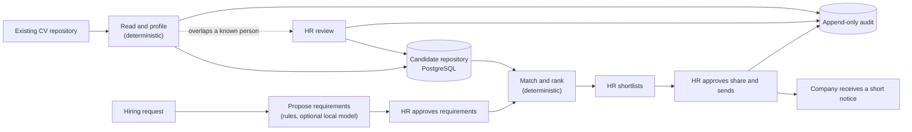

---

## 2. Quick start

Requires Docker with Compose. From the repository root:

```text
docker compose up --build -d
docker compose ps
```

An empty database volume is enough: Compose builds the API, worker and web images, waits for Postgres, runs the migrations, provisions the two
local users, then starts everything. Wait until `web` and `api` show `healthy` (the first build takes a few minutes).

| Surface | URL |
|---|---|
| Recruiter web app | http://localhost:3000 |
| Set up the candidate repository | http://localhost:3000/demo (local environment only) |
| API | http://localhost:8000 (OpenAPI at `/docs`) |
| Mail catcher (Mailpit) | http://localhost:8025 |

**Reproduce the end-to-end story from an empty system, using only the browser:**

1. Open `/demo`. The repository is empty (see the first screenshot in section 5).
2. Click **Choose CV folder** and select the `cvs/` folder. The page says `488 CVs selected`. Click **Import CVs**.
3. The upload takes about ten seconds; the worker then reads the documents in the background and the counts under *Candidate Repository* climb. The page
   says **Import complete** when the queue is empty (1 min 43 s end to end in the measured run in section 25).
4. Open **Candidates** and a profile, then **Review Queue → CV Updates / Duplicates** and decide one.
5. Open `/hiring?new=1`, log a request, approve the proposed requirements, wait for the *Confirmed match pool*, shortlist a candidate, open
   **Review share…** and click **Approve & send**. The message appears in Mailpit.

To start again from an empty system: `docker compose down -v` (this **deletes** the database and stored files) and `docker compose up --build -d`.

If the page says *The API is not reachable*, the stack is still starting. Nothing was uploaded; wait for `healthy` and click **Import CVs** again.

**Optional: a local language model for job descriptions** (nothing leaves the machine; about 1.9 GB download):

```text
docker volume create cadence-ollama
docker compose -f docker-compose.yml -f docker-compose.ollama.yml up -d --build
docker exec cadence-hr-hub-ollama-1 ollama pull qwen2.5:3b-instruct
```

**Run the tests:**

```text
# frontend
cd web && npx vitest run && npx tsc --noEmit

# backend (needs the Postgres container: docker compose up -d postgres)
cd backend && HUB_TEST_DB=hub_test_mine python -m pytest tests -q
```

The backend tests create and use their own `hub_test_*` database on the Compose Postgres (port 15432) and do not touch the `hub` database.
The suite sends two synthetic messages to a running Mailpit; clear the inbox afterwards on a demo machine.

**Local credentials.** Sign-in is a shared bearer token per role (`dev-recruiter-token`, `dev-engineer-token`), accepted **only** when
`ENVIRONMENT=local`. Any other environment refuses to start with a `dev-` token. See [docs/operations.md](docs/operations.md).

---

## 3. The problem

Cadence's HR team hires for Cadence and supports its subsidiaries with external hiring. A subsidiary asks for help filling a role; the team
searches the CVs it holds and sends back a shortlist. Every step is manual today:

- **CVs live in shared folders.** The folders search by file name only. `CV_Ahmed.pdf` does not say whether Ahmed holds a certificate or has eight years in manufacturing.
- **The same person appears many times.** A CV sent through a careers site is saved as another file. One candidate can sit in the folder as five people, and nobody can tell which CV is current.
- **Candidate data is scattered.** CVs in one place, contact details and application history in Excel, requests in email.
- **Requests arrive as free-form email.** One says "we need two accountants", another attaches a full job description. Someone reads each one and pulls out the details by hand.
- **Matching is reading.** To shortlist for a role, the team opens each CV and reads it against the requirements. Nothing records why a candidate was picked or passed over.
- **Sharing is untracked.** It is hard to say which CVs went to which company, or who on the team handled a request.
- **The data is personal.** CVs hold names, phone numbers, emails and photos. Whatever is built has to be defensible.

The hub addresses these. It does not claim to have measured a time saving; none was measured here.

---

## 4. The solution

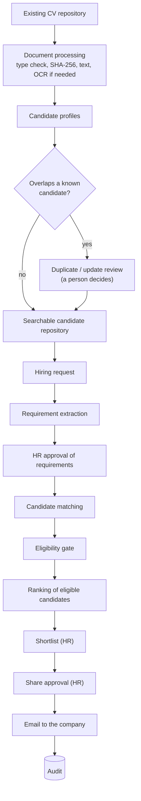

The whole flow is built so that the system proposes and a named person decides at each consequential step (section 18).

---

## 5. Product walkthrough

All screenshots below are real captures of the running application. They were taken only of screens that carry **no candidate data**, because the
corpus is real people's CVs (see [data handling](#31-documentation-index-and-data-handling)). Screens that list candidates, contacts or CV text are
listed afterwards as *withheld*. The images shown are regenerated by
[`scripts/capture_readme_screenshots.py`](scripts/capture_readme_screenshots.py).

### Initial CV repository setup

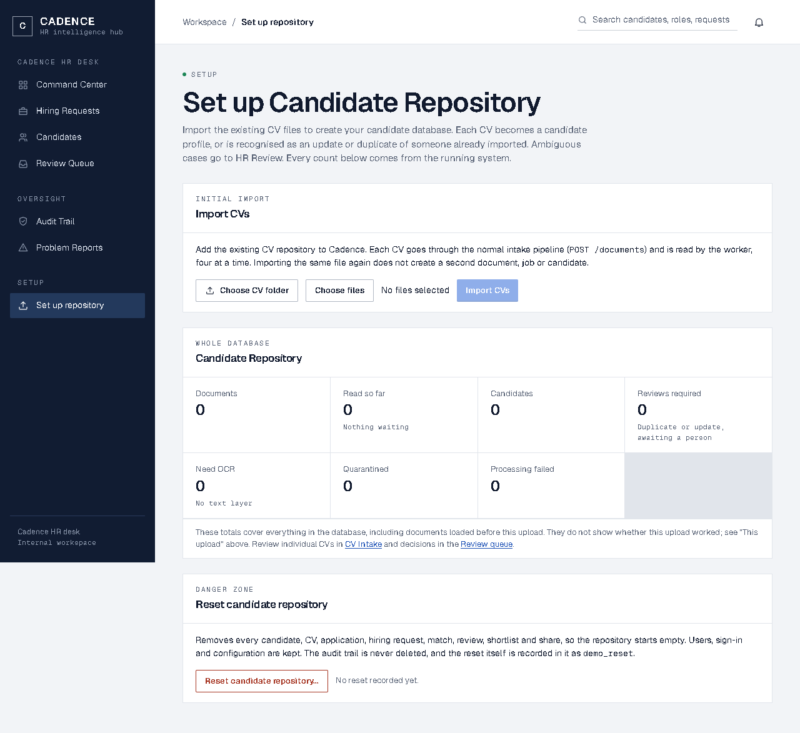

*The system before migration.* The first screen of an empty system: choose the existing CV folder or individual files, then **Import CVs**. Every
number under *Candidate Repository* is read from the running system, not hard-coded. The *Reset* panel at the bottom exists only when the API runs
with `ENVIRONMENT=local`.

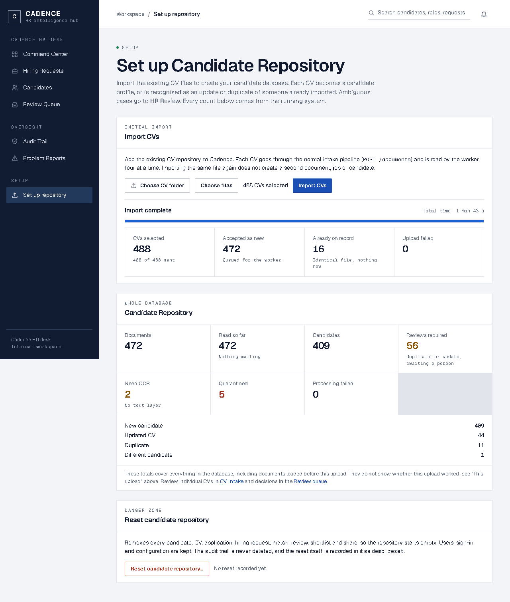

*After the import (488 files, total time 1 min 43 s on a quiet laptop).* The block labelled **This upload** counts only this import (CVs selected, accepted, already on record, failed), and
**Candidate Repository** counts the whole database. They are separate on purpose: if an upload fails the page says so and never reports
*Import complete* (section 10).

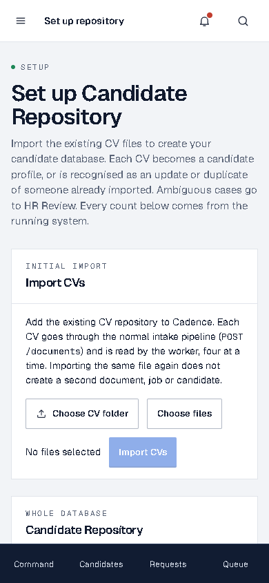 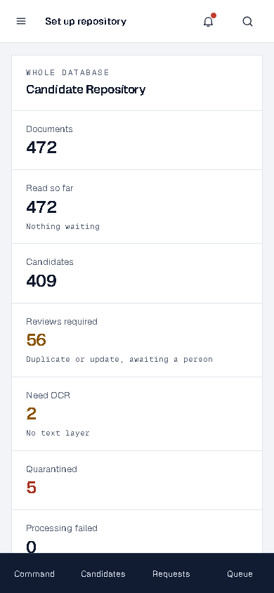

*The same page at 390 px* (two viewport captures). The layout is responsive; on narrow screens the sidebar becomes a menu button and bottom tabs.

### Hiring request and requirement approval

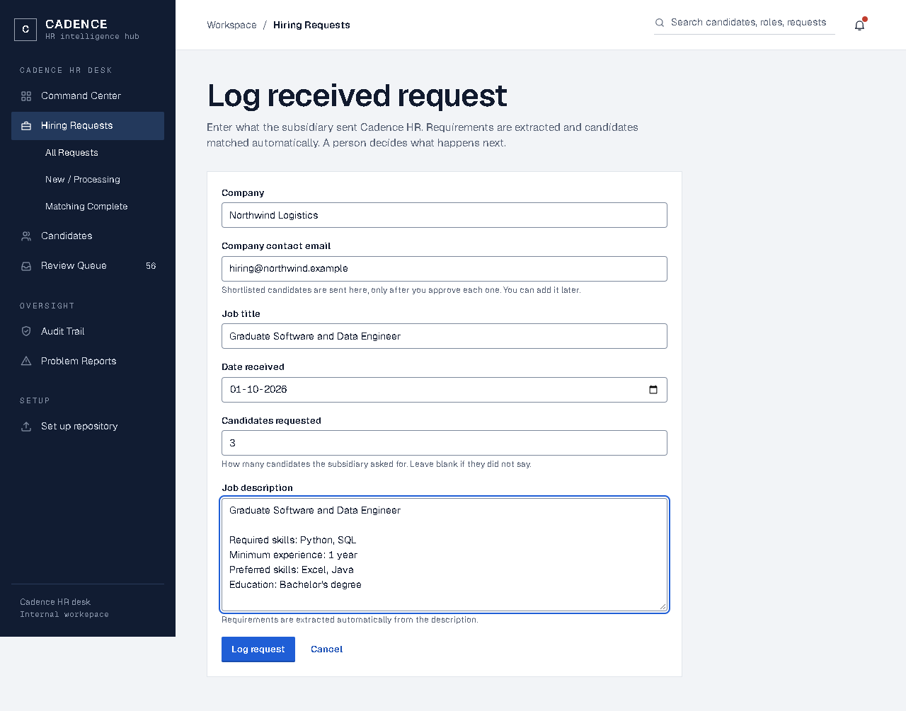

*Log received request.* Company, optional company contact, job title, date received, how many candidates were asked for, and the job description.
Requirements are extracted automatically from the description.

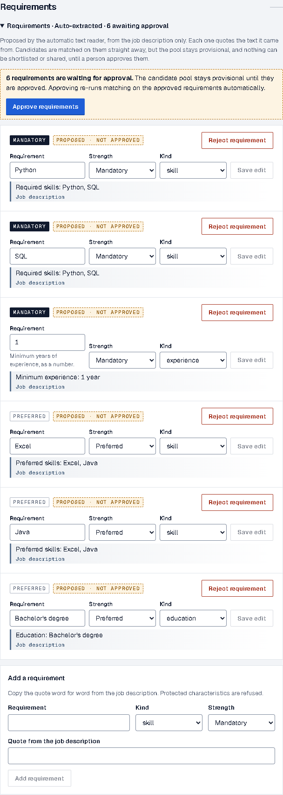

*Requirement approval.* Each proposed requirement quotes the sentence it came from and is marked **Proposed · Not approved**. HR can edit, reject or add
requirements. The candidate pool stays **provisional**, and shortlisting and sharing are refused by the backend, until they are approved.

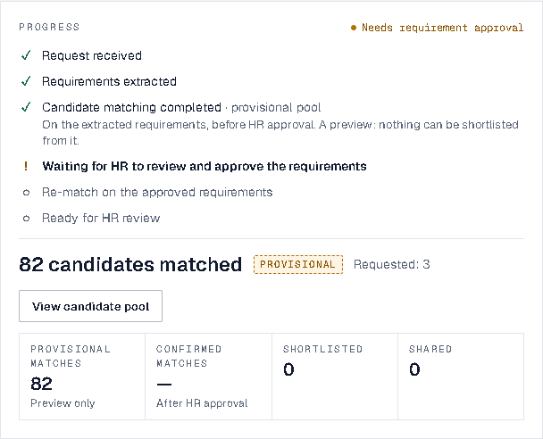

*Request processing.* The card lists the real stages (received, requirements extracted, provisional match, HR approval, re-match, ready). It shows no
percentage because the server reports none.

### Other forms

| | |
|---|---|
| 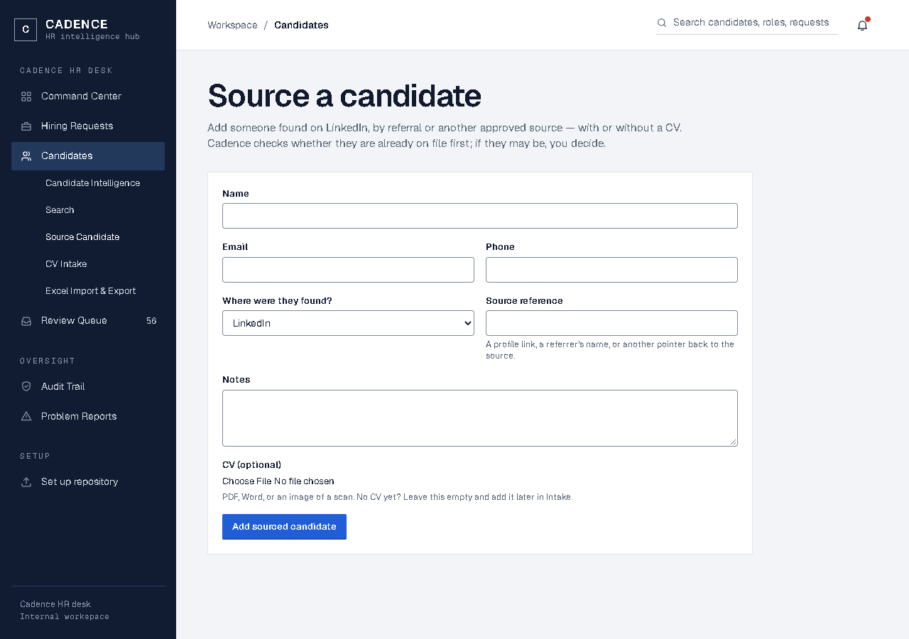 | 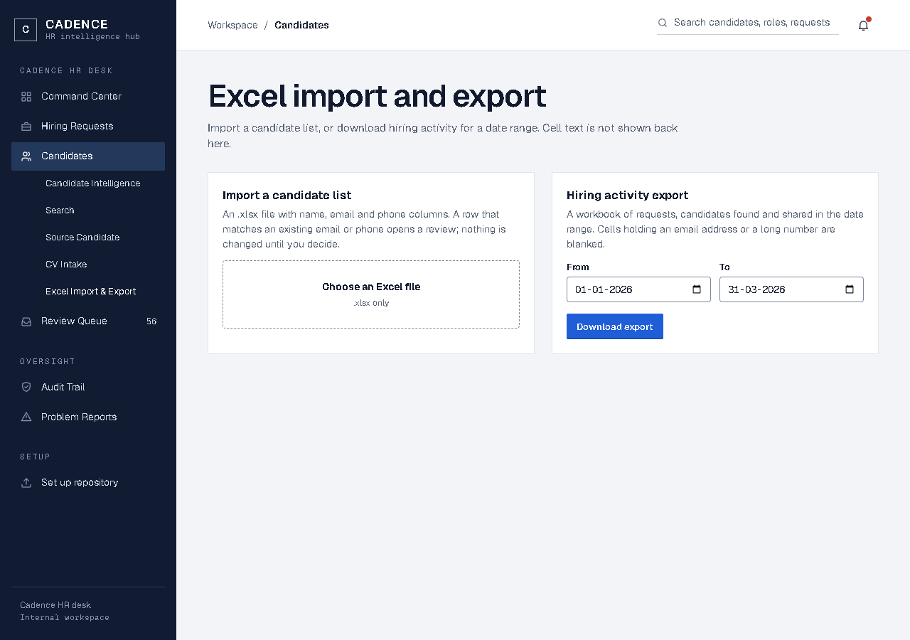 |
| **Source Candidate**: add someone found on LinkedIn or by referral, with or without a CV; Cadence checks whether they are already on file first | **Excel Import & Export**: import a candidate list, or download hiring activity for a date range |
| 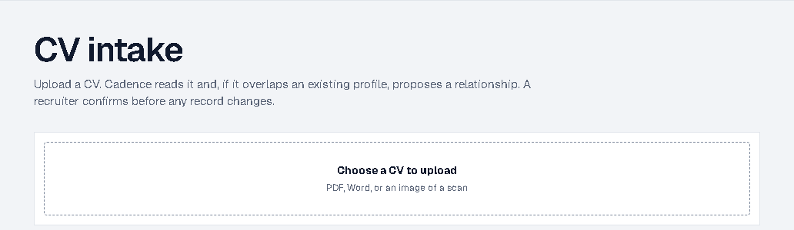 | 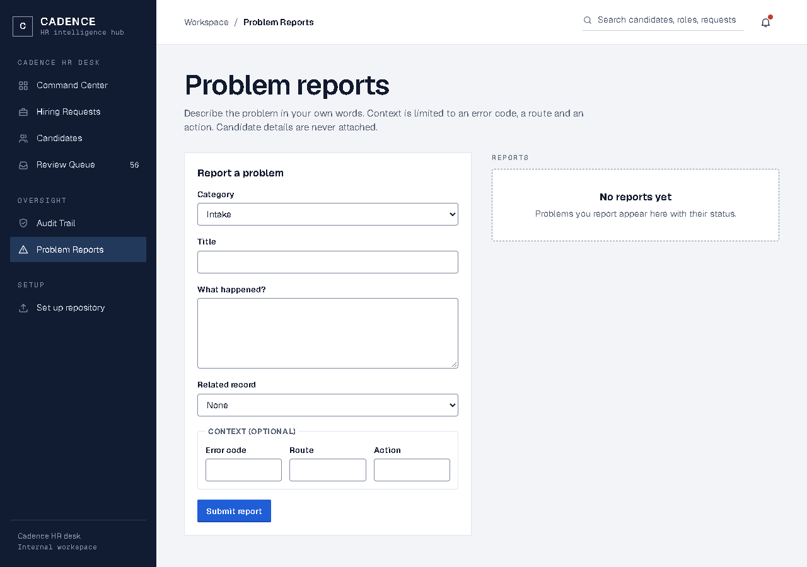 |
| **CV Intake**: upload a CV later; it goes through the same identity workflow as the initial import | **Problem Reports**: describe a problem in a sentence; only an error code, route and action are attached, never candidate details |

### Screens withheld because they show real people

These exist and work; their screenshots are not committed. Capture them locally after an import if you need them, and do not commit the result.

| Screen | Route | What it shows |
|---|---|---|
| Command Center | `/` | Counts and a *Needs you now* list: what happened, what Cadence suggests, the signal strength, one button |
| Candidate Intelligence | `/candidates` | Every confirmed profile; search inside the CVs with the matching passage |
| Candidate profile | `/candidates/<id>` | Overview, experience, education, skills, certificates, current and previous CVs, extracted evidence with page and quote, history |
| Search | `/search` | Filters (name, skill, education, experience, certificate, minimum years, job title, industry, nationality as stated) plus free text |
| CV Updates / Duplicates | `/queue`, `/compare` | Previous CV against new CV with the signals behind the recommendation, the differences, and the source text; one recommended action when confidence is high enough |
| Match pool | `/hiring?request=<id>` | Per-candidate, per-requirement verdicts with the CV quote that supports each; the 0 to 100 score; shortlist and reject |
| Share review | the slide-over on a shortlisted candidate | Exactly what leaves Cadence, the recipient, and **Approve & send** |
| Audit Trail | `/audit` | Who did what, when, to which request, candidate or file (names resolved at read time, never stored in the audit table) |
| Mailpit | http://localhost:8025 | The message the company would receive |

---

## 6. Demo videos

**There are no recorded demo videos in this repository.** A search of the repository found no `.mp4`, `.webm`, `.mov` or `.gif` files and no
hosted-video links, so none are linked here and none are invented. The recordings below are what should be added; each is a screen recording of the
running app, and because the corpus is real people's data, **blur or crop candidate names and contact details before publishing any of them.**

| # | Video | Recommended sequence |
|---|---|---|
| 1 | Full end-to-end workflow | Empty `/demo` → choose `cvs/` → Import CVs → counts climb → Import complete → a candidate profile → one review decision → log a request → approve requirements → confirmed pool → shortlist → Review share → Approve & send → Mailpit → Audit Trail |
| 2 | Duplicate / updated-CV detection | Review Queue → a *Likely an updated CV* item → compare previous and new CV → read the signals → decide → the profile now shows Current CV and Previous CVs |
| 3 | Hiring request to matching | Log a request → proposed requirements with quotes → provisional pool (actions disabled with the reason) → approve → confirmed pool → open a *Needs review* card and read which mandatory requirement is unproven |
| 4 | Controlled candidate sharing | Shortlist → Review share (what leaves Cadence, what does not) → Approve & send → double-click to show one message in Mailpit → the audit entries |

---

## 7. Architecture

### Current local architecture (what runs today)

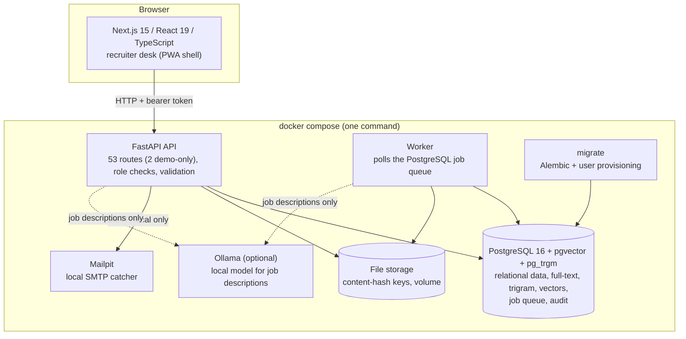

- **API and worker are the same image.** The API validates, authorizes and records; the worker does the slow background work (reading a CV,
  processing a hiring request). Neither the worker nor any "agent" can shortlist, share, merge or decide a review.
- **One PostgreSQL does the work of several systems:** relational data, full-text search, trigram matching, vector similarity, the job queue
  (`FOR UPDATE SKIP LOCKED` with leases) and the append-only audit.
- **Authentication and authorization** are in the API (`api/deps.py`); the UI never decides what a user may do.
- **Mail** is SMTP to Mailpit locally. The Graph and SES senders exist as classes that **refuse to send** until configured.
- **External integrations:** none are connected. SharePoint, OneDrive and Outlook are not integrated.

### Production architecture

The AWS design is in [section 26](#26-production-aws-architecture-plan). **It is a plan; nothing is deployed to AWS.**

---

## 8. Technology stack

| Layer | Technology | Why |
|---|---|---|
| Frontend | Next.js 15, React 19, TypeScript 5.9, Tailwind CSS 4, hand-written components (no UI kit) | One typed codebase for a desk app that must also work on a phone; a small design system keeps the screens consistent |
| Backend | Python 3.13, FastAPI, Pydantic 2, SQLAlchemy 2, Alembic | Typed request validation at the boundary; migrations for every schema change (18 revisions) |
| Database | PostgreSQL 16 (`pgvector/pgvector:pg16` image) | One transactional store for profiles, evidence, approvals and audit, so constraints and locks can make double-actions impossible |
| Search | PostgreSQL full-text (`tsvector`, `simple` config), `pg_trgm` trigram similarity, `pgvector` HNSW index | Keyword, fuzzy and vector signals in one query path, no second system to keep in sync |
| Documents | PyMuPDF (PDF), python-docx (DOCX), LibreOffice (legacy DOC), Pillow | Text-layer reading with page-accurate quotes; two-column layout handling for PDFs |
| OCR | Tesseract (via pytesseract) | Local and free; production would use a managed OCR adapter (not built) |
| AI | Optional local `qwen2.5:3b-instruct` through Ollama, for job descriptions only | A language model only where language has to be interpreted; runs locally so a job description never leaves the machine |
| Queue | PostgreSQL job table with leases, idempotency keys and retry limits | No extra infrastructure at this scale; SQS is the production option when several workers run |
| Email | SMTP to Mailpit locally; Graph and SES senders are fail-closed placeholders | Real sending is a configuration change, but is blocked until a destination is configured |
| Excel | openpyxl | Cells are read as data, never evaluated |
| Testing | pytest (backend), Vitest + Testing Library + jsdom (frontend), Playwright scripts (browser checks) | See section 23 |
| Deployment | Docker Compose locally. **AWS (ECS Fargate, RDS, S3 and others) is a plan, not deployed** | Section 26 |

---

## 9. Data model

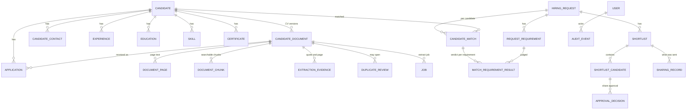

The 32 tables (`backend/app/models/core.py`, `hiring.py`) also include `users`, `field_locks`, `agent_runs`, `quarantine_records`,
`candidate_sources`, `excel_imports`, `excel_import_rows`, `request_notes`, `request_attachments` and `problem_reports`.

**The mental model that the rest of the system depends on:**

| Concept | Meaning |
|---|---|
| **Candidate** | A person. One profile per person. |
| **Document** | A CV file, one version of evidence. It is stored by SHA-256, belongs to at most one candidate, and is either the current CV or history. |
| **Application** | An occasion a candidate applied, tied to the document that arrived with it. |
| **Evidence** | A stored quote with its page. A profile fact without a verified quote is not stored. |
| **Requirement** | One thing a company asked for, with the sentence it came from, mandatory or preferred, and a review status. |
| **Match** | A candidate compared with a request's requirements: one verdict per requirement, with evidence. |
| **Eligibility** | Whether a candidate may proceed. Decided by mandatory requirements only. |
| **Score** | A 0 to 100 ranking among eligible candidates. It never decides eligibility. |
| **Approval** | A recorded human decision. Only a recruiter can create one. |
| **Audit** | The append-only history of who did what. |

---

## 10. Initial repository import (real CV ingestion)

The 488 files in `cvs/` are not sample data to be "loaded". They stand in for the company's existing CV repository, and the first-run flow is an
**initial migration** into an empty system: import the existing files, build one profile per person, send ambiguous cases to HR, and from then on
treat the result as the live candidate repository. New CVs after that arrive through **CV Intake** and follow exactly the same workflow.

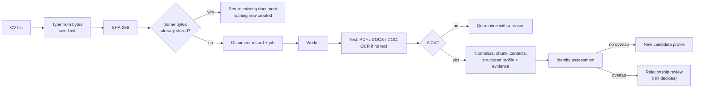

How it behaves, from the code:

1. **The browser sends each file to `POST /documents`**, four at a time. The import page does not use a separate path.
2. **File validation.** The type is detected from the file's bytes (PDF, DOCX, legacy DOC, JPEG, PNG), never from its name or extension. Anything else is
   refused (415). Files over 20 MB are refused (413). The stored filename is sanitized.
3. **Identical bytes are one document.** The SHA-256 is taken under a Postgres advisory lock, so a retry, or the same file twice in one batch, cannot race
   past the lookup. A repeat returns the existing document (`created: false`) and writes a `same_document` audit entry.
4. **The worker reads the document.** Text comes from the PDF text layer, from DOCX, from legacy DOC through LibreOffice, or from Tesseract OCR when
   there is not enough text. A scan with no readable text becomes `needs_ocr`; it never becomes an empty profile.
5. **A CV / non-CV gate** quarantines invoices, cover letters and job descriptions with a reason code. A corrupt or encrypted PDF is quarantined too.
6. **Profile facts** are extracted by a deterministic section parser. Each fact is stored only with a quote that exists in the source page.
7. **Identity assessment** compares the CV with existing candidates (section 12). With no overlap, a new candidate is created. With overlap, **no
   candidate is created or changed**: a relationship review opens and the document waits for a person.

**The import page tells the truth about the upload.** It checks that the API answers before it sends anything; it reports an unreachable API, an unreadable
file and a server rejection as different things; it keeps *this import's* counts separate from the whole-database totals; and it never says
*Import complete* when nothing was accepted. Retrying only re-sends the failed files, and re-importing the same folder creates nothing new
(regression tests in `web/lib/__tests__/` and `web/app/demo/__tests__/`).

**What repeated ingestion does.**

| Input | Result |
|---|---|
| The same bytes again | Same document returned, nothing new created |
| An updated CV of a known person | A relationship review, labelled *updated CV*; the profile does not change until a person decides |
| A duplicate (same person, same content) | A review, labelled *duplicate* |
| Someone who shares only a name or one contact with a known person | A review that offers all three actions with no recommendation |
| A different person | A new profile, or a review recommending *create new* when the signals are strong enough |
| Corrupt, encrypted or non-CV file | Quarantined with a reason code; the batch carries on |
| A scan or phone photo with no readable text | `needs_ocr` |

---

## 11. Candidate profile

One person is one profile. A profile holds contacts (email and phone, raw and normalized), experience, education, skills, certificates, the
applications that created it, and every CV document that belongs to it, with the **current CV** and the **previous CVs** shown separately. Each
fact links to the evidence row that holds its quote and page; the profile page lets a recruiter open the source of any fact.

**Why document versions are separate from candidates.** A candidate is a person; a CV is a version of evidence about them. Keeping them apart means
an updated CV does not overwrite history, a duplicate file does not create a second person, a decision can be explained ("this CV replaced that
one"), and the old CV stays available for audit and comparison.

When HR accepts an updated CV, the new CV becomes current, the previous one stays as history, and the new CV's facts are read into the profile with
verified quotes. A fact an earlier CV already gave is kept once.

---

## 12. Duplicate and updated-CV detection

The number shown on a review is a **same-person confidence from 0 to 100**. It is computed in `backend/app/domain/confidence.py` from explainable
signals. **A model's self-reported confidence is not an input, and filename wording is not an input.**

**Identity (is it the same person?).** Each agreeing signal removes a share of the *remaining doubt*, so independent agreements add up without ever
passing 100:

| Signal | Share of remaining doubt removed when it agrees |
|---|---|
| Exact email | 90% |
| Exact phone (the same number written two ways counts) | 80% |
| Name | up to 50%, times the name similarity (so a name alone never reaches high confidence) |
| Content overlap (employment, education, skills, similarity) | up to 30% |

A signal that could not be read on both CVs is **missing**: it is left out and lowers nothing. A **different** email (cuts the result by 50%) or a
different phone (40%) on both CVs is a **contradiction**, and a contradiction blocks any recommendation.

**Relationship (what kind of match?).** Only for a pair that looks like one person: newer dates and changed content say *updated CV*; matching
content says *duplicate*. This picks the label. It never lowers the identity number.

**Recommendation threshold.** One action is recommended only at confidence **98 or above** with no contradiction, which takes two exact contacts
that agree. Below that, a person chooses among all three actions with no suggestion. Two existing people who both look related make the review
*ambiguous*, capped below the threshold, with no recommendation.

Computed with the real scoring function (defaults as shipped), to show the behaviour:

| Evidence | Confidence | Label | Recommendation |
|---|---:|---|---|
| Exact email + exact phone + same name, newer dates | 99 | updated CV | **Merge & Update Profile** |
| Exact email + same name only | 95 | updated CV | none: HR chooses |
| Exact email + name + 60% content overlap | 96 | duplicate | none: HR chooses |
| Same name only, no contact to compare | 50 | updated CV | none: HR chooses |
| Exact phone, **different email**, same name | 45 | updated CV | none (contradiction): HR chooses |
| Different email **and** different phone, similar name | 7.5 | different person | none |
| Exact email + phone, older dates, high overlap | 99 | duplicate | **Delete Duplicate** |
| Two existing candidates both look related | 97 (capped) | ambiguous | none |

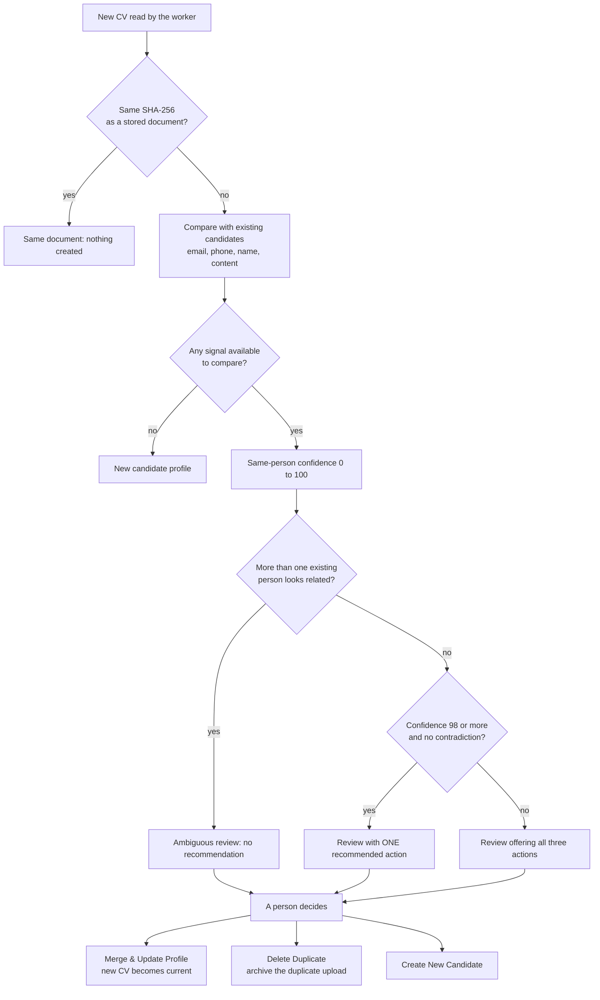

**What each decision does.** *Merge & Update Profile*: the incoming CV becomes current, the previous one stays in history, and the new CV's facts are
read into the profile. *Delete Duplicate*: the duplicate upload is archived, never deleted. *Create New Candidate*: a new profile is created and
the existing one is unchanged. Only a person can take these (`human_required` otherwise), and a second decision on the same review is refused (409).

**Why deterministic signals and not an LLM.** Joining two different people is worse than missing a duplicate. The signals here are inspectable (every
review shows each signal, its weight and its state), reproducible (the same two CVs always give the same number), testable (`test_identity_confidence.py`
and the corpus runs) and free of per-file model cost. An LLM judgement would be none of those. The weights are a starting point, **not a validated
model**: the config says so, and tuning them against labelled data is future work (section 29).

---

## 13. Search

Search is hybrid and lives in PostgreSQL (`backend/app/services/search.py`):

| Layer | What it does |
|---|---|
| **Structured filters** | Name, skill (with fuzzy match on skill names), education, experience, certificate, minimum years, job title, industry, and *nationality as stated* (a text match on what the CV says; nationality is **never inferred** or stored as an attribute) |
| **Full-text** | `tsvector` over each chunk (`simple` configuration), ranked with `ts_rank` |
| **Trigram** | `pg_trgm` similarity over chunk text for fuzzy matches |
| **Vector** | Cosine distance over a 1,024-dimension vector per chunk, used to rerank lexical hits |
| **Evidence** | Every hit returns the passage and the reasons it matched |

**The vectors are not semantic.** The default embedder (`LocalFeatureEmbedder`) hashes each token into a fixed 1,024-dimension vector: shared words raise
the similarity, but it has **no understanding of meaning** ("Python developer" and "software engineer who writes Python" are related only if they share
words). The `bedrock` embedder is a placeholder that refuses to run. This is **keyword-and-fuzzy search with a hash-vector component, not
"semantic AI search"**. The schema stores a fixed 1,024-dimension column and an HNSW index, so a real embedding model could replace the hash without a
schema change; none has been evaluated. A mandatory requirement never uses the vector at all (section 17).

---

## 14. Hiring requests

A request holds the company, the role, the description, the date received, an owner, an optional company contact email (where an approved shortlist
is sent), the number of candidates requested, requirements, matches, a shortlist, sharing records, notes, next steps, updates and attachments.

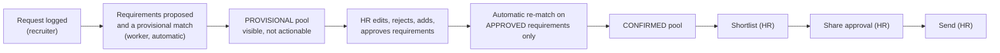

- **Matching is never blocked on approval.** The first match runs on the proposed requirements so HR can see something immediately, but the pool is
  labelled **Provisional** and the backend refuses shortlist, share approval and send with `409 pool_provisional`.
- **Approving requirements queues a re-match** that uses approved requirements only. Rejected requirements are kept, labelled, and never matched on. Editing
  a requirement sends the pool back to provisional.
- **The pool status is derived, not stored:** confirmed means every requirement has a decision, at least one is approved, the last match is newer than the
  last change, and no matching job is queued or running.
- **What a request reads in the UI:** *Processing, Needs requirement approval, Matching, Ready for review, Active* (or *Processing failed*, with a retry).
  **Nothing closes or cancels a request**, so there is no "Completed" state; the `closed` and `cancelled` states exist in the state machine but nothing sets them.
- **Not preserved:** the provisional pool's per-candidate verdicts are overwritten by the re-match. What remains is the audit (one `matching_run` event per
  run) and the agent runs.

---

## 15. AI architecture

**Where AI is used, exactly.**

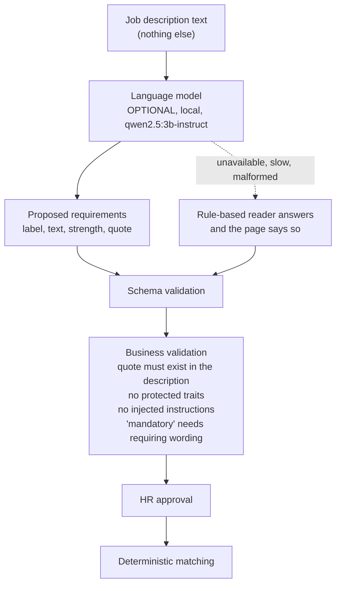

| Component | Method | What it receives | Is it AI? |
|---|---|---|---|
| **Requirement reader** | Optional local `qwen2.5:3b-instruct` via Ollama, prompt `requirements-llm-v2`, with a deterministic rule reader as the default and as the fallback | The job description only. No candidate data, no CV text | **Yes**, the only language model in the product |
| OCR | Tesseract | A page image | Classical OCR, local |
| Vector component of search | Token hash, 1,024 dimensions | Chunk text | **No.** An approximation, not a model |
| CV text extraction, section parsing, CV / non-CV gate | Rules | The CV | No |
| Identity scoring, matching, scoring, state machines, audit, authorization | Rules | Stored fields | No |
| `bedrock` providers (extractor, embedder, requirement reader) | Placeholders that raise `…Unavailable` | Nothing | Fail closed; not implemented |

**By default no model runs.** `docker compose up` builds the deterministic version: requirements are proposed by the rule reader, which reads labelled lists
(`Required skills: Python, SQL`, `Minimum experience: 3 years`, `Preferred skills: Excel`), pasted short-line lists and a few explicit phrases. The
local model is an opt-in overlay (section 2).

### Where AI is not used

- Authorization and permissions
- Identity authority (whether two CVs are the same person)
- The final shortlist
- Sharing authorization
- Audit integrity
- Mandatory business rules (an unmet mandatory requirement excludes; a similarity score can never clear it)

> **AI recommends. Deterministic services enforce. Humans decide consequential actions.**

**What guards the model's output** (`domain/requirement_schema.py`, `domain/protected.py`, `extraction/llm_requirements.py`): the reply must match a JSON schema;
the quote must exist verbatim in the job description and the requirement text must sit inside its quote; protected characteristics (religion,
nationality, ethnicity, gender, marital status, age) are rejected in the text and in the clause it came from; an instruction such as "ignore previous
instructions" or "shortlist all" is rejected, as is any skill inside an injected sentence; an experience number must be a count of years, not an age; a
"mandatory" item whose sentence does not require it is demoted to preferred (never promoted). Every proposal then waits for HR.

**If the model is wrong or unavailable.** The 3B model is weak: it can miss a requirement or rate a required one as preferred. That is acceptable only
because HR reviews every requirement before it is used. If the model is unreachable, too slow, or returns malformed output, the rule reader answers and the page
says which reader answered and why. On the hardware this was developed on (a Docker VM with 3.6 GB of memory) the model sometimes exceeded its
timeout and the rule reader answered; see [`SUBMISSION.md`](SUBMISSION.md) section 7. A larger or hosted model is a configuration change and was not evaluated.

---

## 16. Why not use an LLM everywhere?

Because for most of this system the cost of a wrong answer is high and the right answer can be written down.

| Concern | Rule-based code | An LLM in the same place |
|---|---|---|
| **Determinism** | The same two CVs always produce the same confidence | The same two CVs can produce different answers on different days |
| **Explainability** | Each review lists every signal, its weight and its state | "The model thought they were the same person" |
| **Testability** | Boundary tests: exact email + exact phone = 98, email alone < 98 | An evaluation set that has to be built and re-run for every model change |
| **Cost and latency** | $0 and milliseconds per comparison; the 488-CV corpus runs with no model | A model call per file or per pair; on local hardware the 3B model took tens of seconds per job description |
| **Privacy** | CV text never leaves the machine | CV text would have to be sent to a model |
| **Failure modes** | Missing data is "unknown", never a hidden rejection | A confident wrong answer, indistinguishable from a right one |
| **Business rules** | "A mandatory gap excludes" is enforced in code | A prompt that asks the model to remember a rule |

Concrete examples from this project: merging two people is the costly mistake, so it is a deterministic score a person confirms. Letting a model clear
a mandatory requirement would make the shortlist unauditable, so eligibility is decided only from verdicts that each cite a CV quote. The one place
language is genuinely free-form, a company's job description, is where a model is allowed to *propose*, and even there only behind validation and approval.

---

## 17. Candidate matching

Matching (`domain/matching.py`, `services/matching.py`) judges **each requirement separately**, for each candidate, from that candidate's own current
CV and verified profile facts. Nothing depends on other candidates, and a similarity score or search rank never sets a verdict.

| Verdict | Meaning |
|---|---|
| **Meets** | A verified profile row or a CV line supports it; the quote is stored |
| **Partial** | Named elsewhere on the CV (coursework, a minor, a certificate mentioned but not clearly held, a degree still expected) |
| **Unmet** | Nothing on the CV names it, and the whole CV was read as text |
| **Unknown** | No evidence either way, for example no years of experience on the profile, or only OCR text that could have garbled words |

**Eligibility gate (decided by mandatory requirements only):**

| Mandatory requirements | Result |
|---|---|
| Any **unmet** | **Excluded** |
| Any **partial** or **unknown** (none unmet) | **Needs review** |
| All **met** | **Eligible** |

**Only eligible candidates get a score.** The 0 to 100 score is built from verdicts alone: mandatory requirements share 70 points and preferred ones
share 30 (if only one kind exists it shares all 100); *meets* earns the full share, *partial* half, *unmet* and *unknown* nothing. Shares are cut in
tenths and always add up, so every point on a card traces to one requirement. A blocked candidate gets **no score at all, not a low one**.

**Why the score is not eligibility.** If a score decided eligibility, a candidate with strong preferred skills could outrank a mandatory gap. Here the
gate runs first and the score only orders the people who passed it. A "Needs review" candidate is shown with the mandatory requirement that is not
clearly met, never silently passed or rejected.

A rejection by a recruiter survives a re-match. The score never shortlists anyone: the matcher proposes, a recruiter decides.

---

## 18. Human in the loop

| Action | System proposes | A recruiter must act | Enforced by the backend |
|---|:---:|:---:|---|
| Requirement extraction | ✓ | ✓ approve / edit / reject / add | Pool stays provisional until decided |
| Duplicate / updated-CV relationship | ✓ recommendation | ✓ decide | `human_required` for any non-user actor |
| Matching and eligibility | ✓ | review (needs-review cases) | Deterministic; recruiter-only to act on it |
| Shortlist | none | ✓ | Refused for a provisional pool and for non-recruiters |
| Reject / restore a match | none | ✓ | Recruiter-only |
| Profile merge | none | ✓ explicit confirmation | Recruiter-only |
| Share approval | none | ✓ | Needs a confirmed pool and a shortlisted, still-matching candidate |
| Send email | none | ✓ | Needs an approval and a company contact; sends once |
| Excel rows that match an existing person | ✓ | ✓ same review | Recruiter-only import |
| Problem reports | | recruiter files, engineer changes status | Role checks |

Authorization is enforced in the API, not the UI: the system and worker actors cannot merge, shortlist, share, decide a review or import a spreadsheet.
Every decision is saved with who made it, when, and what the system had suggested.

---

## 19. Security

| Area | What the code does |
|---|---|
| **Authentication** | A bearer token per role, compared with `secrets.compare_digest`. Demo tokens (`dev-…`) work only when `ENVIRONMENT=local`; elsewhere the process **refuses to start** with one, and the two tokens must differ. Per-person sign-in is **not built** |
| **Authorization (RBAC)** | Checked in the API for all 53 routes against recruiter and engineer roles. A missing token is 401 on every route except `/health`, `/docs`, `/openapi.json`; a wrong role is 403. The web app is recruiter-only |
| **Input validation** | Pydantic models at the boundary (the request, report and requirement models reject unknown fields); free text is length-limited; ids are typed UUIDs |
| **File validation** | Type detected from bytes, not the name; 20 MB cap; filenames sanitized; a corrupt or encrypted PDF is quarantined. **No malware scanning** |
| **SQL** | SQLAlchemy ORM and bound parameters. The one dynamic statement is the local backup job, which interpolates table names read from the database schema, never request input |
| **Secrets** | Read from the environment (`pydantic-settings`), never from the repo; tokens must be at least 8 characters. Compose contains local demo tokens only |
| **PII by role** | Contacts, CV text, evidence and page previews need a recruiter; an engineer sees document metadata only. Opening CV text is itself audited. Page previews return an image of one page, never the original file |
| **Protected traits** | Nationality, age, gender, religion, race, ethnicity, marital status are never inferred, stored as attributes, or accepted as requirements |
| **Prompt injection** | The job description is treated as data; injected instructions and any skill inside an injected sentence are rejected before they can become a requirement |
| **Excel** | Formulas and instruction-like cells are never executed, stored or copied to the audit; export omits email, phone and summaries |
| **Outbound mail** | The message holds company, role, the candidate's name, years of experience, the requirements of *this request* that were met, and a reference id. **No email, phone, CV file, job title or raw skills list** leaves Cadence. In the local environment mail can only go to the local SMTP catcher |
| **Problem reports** | Only a fixed set of safe context fields; passwords, tokens, embeddings, email addresses and long digit runs are refused |
| **Logging** | Audit rows carry ids and codes, never CV text or contact values (see section 20) |
| **CORS** | An explicit origin list (`CORS_ORIGINS`) |
| **Encryption, backups, retention** | Local: backup job (table snapshots plus stored files) and a 730-day retention that **archives, never deletes**. Encryption at rest, KMS and managed backups are part of the AWS **plan**, not implemented |

**Not implemented / known limits:** no rate limiting; no malware scanning; no TLS termination locally; two shared role tokens; the application database
role is a superuser (see audit); no full CV-store export.

---

## 20. Auditability

`audit_events` is append-only. Rows are written by `services/audit.py`, which accepts only an allow-listed set of detail keys (ids, status codes,
counts, outcome codes, a rounded confidence). It refuses an `@`, floats and unknown keys, so contact details and CV text cannot be written by accident.

Each row records the **actor** (user, system or agent), **what** (action), **when**, the **related entity**, and safe metadata. Examples of actions
recorded: `document_received`, `same_document`, `document_extracted`, `document_needs_ocr`, `job_quarantined`, `duplicate_review_opened`, the human decision
on a review, `hiring_request_created`, `requirements_extracted`, `requirements_changed`, `matching_run`, `pool_opened`, `shortlist_decision`,
`share_approved`, `candidate_shared`, `candidate_share_failed`.

The audit page resolves the names a recruiter wants to read **at read time**, from the rows the ids point to, so nothing personal is written into the audit
table itself.

**Intentionally not stored in the audit table or logs:** CV text, email addresses, phone numbers, embeddings, file contents.

**Honest limitation.** Database triggers reject `UPDATE`, `DELETE` and `TRUNCATE` on `audit_events` for every ordinary session, including the application's.
**The application connects as the database owner (a superuser in Compose), so an operator who first disables the trigger could still change rows.** The table is
append-only for the application, not against the database owner. A production design would give the application a role without that power (section 29).

---

## 21. Failure modes and edge cases

Only behaviour that exists in the code or tests is listed.

| Failure | Handling |
|---|---|
| Corrupt PDF | `corrupt_pdf`: the job and document are quarantined with a record; the batch carries on |
| Encrypted PDF | `encrypted_pdf`: quarantined |
| Non-CV document (invoice, cover letter, job description) | Quarantined with a `non_cv_*` reason |
| Unsupported or empty file / over 20 MB | 415 `unsupported_file` / 413 `file_too_large`; nothing stored |
| OCR unavailable | Document becomes `needs_ocr` with `ocr_unavailable`; no empty profile |
| Scan with no readable text | `needs_ocr` with `insufficient_text` |
| Duplicate upload (same bytes) | Advisory lock, then the existing document is returned; one document, one job (concurrency test) |
| Updated CV / duplicate of a known person | A review opens; nothing is attached or changed until a person decides |
| Same name only | Confidence 50 at most from the name; no recommendation; HR chooses |
| Conflicting phone or email | Marked a contradiction; confidence is cut; no single recommendation |
| Two existing people look related | Ambiguous review, confidence capped below the threshold |
| LLM or rule reader proposes an invalid requirement | Schema, quote, protected-trait and injection checks reject it; the reason code is recorded, the text is not |
| Prompt injection in a job description | The sentence and any skill in it are refused |
| Model unreachable, too slow, or malformed | The rule reader answers and the page says so, with the reason |
| Worker crashes mid-job | The lease expires and the job is reclaimed once; the job table's idempotency key is a unique constraint, so no duplicate rows (`test_lease_can_be_reclaimed_after_it_expires`, `test_job_idempotency_is_a_database_constraint`) |
| Transient job error | Retried up to 3 attempts, then quarantined |
| Duplicate job execution | Prevented by the unique idempotency key |
| Concurrent shortlist clicks | The request row is locked: one draft shortlist, one entry (`test_parallel_shortlist_clicks_open_one_shortlist`) |
| Concurrent approve-and-send | One approval, one sharing record, one email (`test_parallel_approve_and_send_emails_the_company_once`) |
| Retry after a successful send | Returns the same record, no second email |
| Email send failure | `candidate_share_failed` is audited, no sharing record is written, nothing is counted as shared; a retry sends exactly once |
| Unauthorized API call | 401 without a token on every protected route; 403 for the wrong role |
| Upload fails in the browser | The import page distinguishes API unreachable, file unreadable and server rejection, keeps the files selected, and never reports completion |

---

## 22. State machines

Status changes go through one function, `domain/transitions.py`, so no caller assigns a status directly. Human-only steps are refused for a system actor.

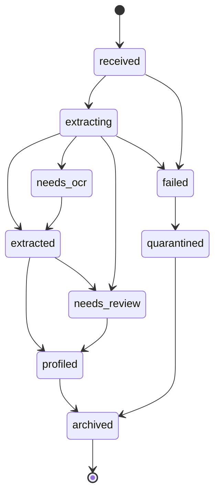

*Document (abridged: it omits some archive and failure edges).* `needs_review` is a CV waiting for a person to decide a relationship; `quarantined` is a file the system refused, with a reason.

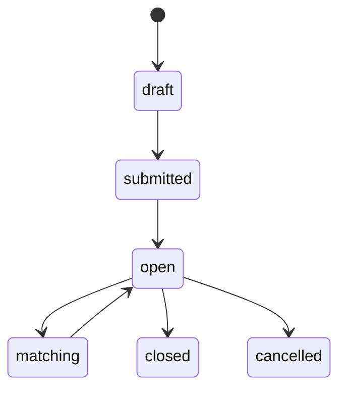

*Hiring request.* `closed` and `cancelled` exist, but **nothing currently sets them**. Whether a pool may be shortlisted or shared is **derived** from the
requirements (section 14), not stored here.

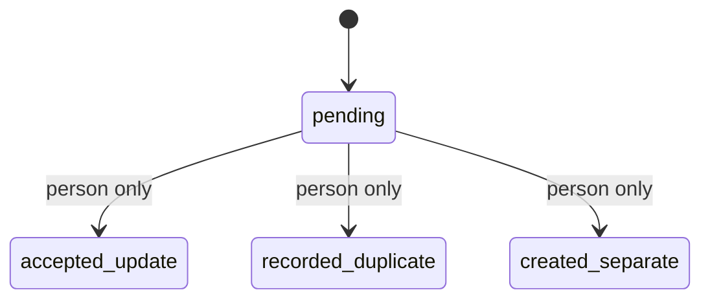

*Duplicate review.* The three terminal states can only be reached by a user.

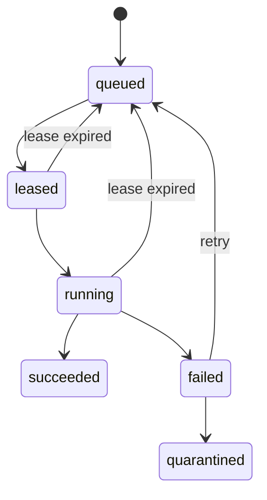

*Background job (abridged).* Leases, retries (3 attempts) and quarantine are enforced here. A *problem report* moves `open → in_progress → resolved`.

**Shortlist and share are not a stored state machine.** They are derived from rows: a candidate is *shortlisted* (a `shortlist_candidates` row), *approved*
(an `approval_decisions` row of type `share`), and *sent* (a `sharing_records` row), each guarded by a row lock and a unique constraint.

**Why the backend owns transitions.** If a screen could set a status, a double click, a second tab or a stale page could skip a step that carries a
rule (a provisional pool being shortlisted, a share sent without approval). Putting every transition behind one function and database constraints makes
those mistakes impossible rather than merely unlikely, and lets tests assert them.

---

## 23. Testing

Measured on this repository on 1 October 2026:

| Suite | Result |
|---|---|
| Backend (`pytest`, real PostgreSQL) | **376 passed, 1 skipped** (the skipped test calls the real local model and runs only with `OLLAMA_LIVE=1`; it was not run) |
| Frontend (Vitest, jsdom) | **193 passed** in 27 files |
| TypeScript (`tsc --noEmit`) | **clean** |
| Browser | Playwright scripts drive real Chrome: `scripts/browser_import_check.py` (1, 5 and 488 files, desktop and 390 px) and `scripts/capture_readme_screenshots.py`. Run by hand; **there is no CI pipeline in the repository** |
| Corpus | The 488-file runs are scripts (`corpus_baseline.py`, `empty_db_timing.py`, `browser_import_check.py`) and were run by hand. `test_corpus_gates.py` uses documents generated inside the test, not the real CVs |

Examples of tests that pin the important behaviour:

| Area | Tests |
|---|---|
| **Concurrency** | `test_parallel_approve_and_send_emails_the_company_once`, `test_parallel_shortlist_clicks_open_one_shortlist`, `test_parallel_create_new_candidate_clicks_create_one_profile`, `test_concurrent_uploads_of_identical_bytes_create_one_document_and_one_job` |
| **Retry safety** | `test_retrying_after_a_successful_send_returns_the_same_record_and_no_new_email`, `test_a_failed_send_is_recorded_not_counted_and_the_retry_sends_exactly_once`, `test_retrying_the_same_files_creates_no_duplicate_document_job_or_candidate` |
| **Security** | `test_missing_token_is_401_on_every_protected_route`, `test_wrong_role_is_forbidden`, `test_tokens_are_required_settings_and_demo_tokens_stay_local`, `test_candidate_pii_stays_with_the_recruiter`, `test_audit_update_is_rejected_and_inserts_still_work`, `test_audit_delete_is_rejected` |
| **Data minimisation** | `test_the_company_email_names_requirements_met_not_hobbies`, `test_a_job_title_never_leaves_cadence` |
| **Worker** | `test_lease_can_be_reclaimed_after_it_expires`, `test_job_idempotency_is_a_database_constraint` |
| **Identity** | `test_identity_confidence.py`, `test_relationship_actions.py`, `test_review_compare.py` |
| **Requirements and matching** | `test_llm_requirements.py` (validation, injection, protected traits), `test_matching.py`, `test_score.py`, `test_requirement_review.py` |
| **Import UX regression** | `web/lib/__tests__/api-upload.test.ts` (correct API URL, one unreadable file, connection error versus server rejection), `upload-batch.test.ts` (batch counts, retry, total outage), `web/app/demo/__tests__/demo-data.test.tsx` (no *Import complete* after a total upload failure, preflight, retry, accurate counts) |

No coverage percentage is claimed; none was measured.

---

## 24. Real corpus results

The corpus is the 488 files in `cvs/`, which come from a real HR team's shared folder (real people; see data handling). Results are from a fresh
database imported **only through the browser UI** on the current code.

**Files on disk:** 488 (459 PDF, 26 DOCX, 2 JPEG, 1 JPG), about 71 MB.

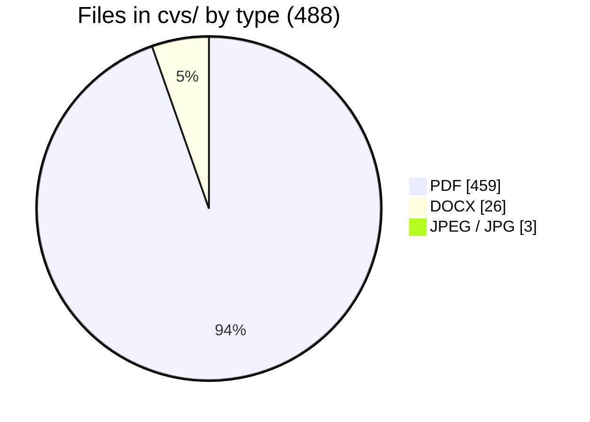

**Import and processing outcome (latest verified run).**

| Measure | Result |
|---|---|
| Uploads | 488 of 488 returned HTTP 201; 0 failed requests; no console errors |
| New documents / already on record | 472 / 16 (16 byte-identical copies are recognised as the same document) |
| Documents stored | 472 |
| Candidate profiles | 409 |
| Relationship reviews opened (pending) | 56 |
| Needs OCR | 2 |
| Quarantined | 5 |
| Processing failures / stuck jobs | 0 / 0 |
| Quarantine reasons (5) | `corrupt_pdf`, `encrypted_pdf`, `non_cv_invoice`, `non_cv_cover_letter`, `non_cv_job_description` (one each) |
| Needs-OCR reason (2) | `insufficient_text` for both: no text layer and OCR found too little |
| Jobs | 467 succeeded, 5 quarantined |

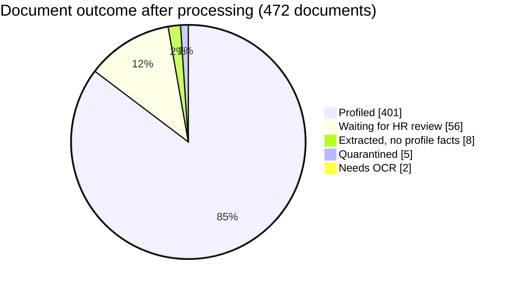

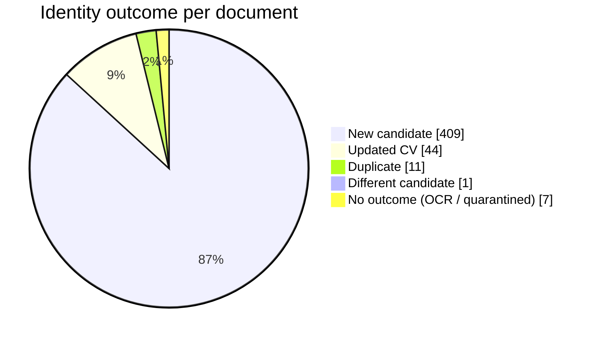

**Repeated-run consistency.** The same corpus was imported from an empty database in two independent browser runs on the current code and gave the same
counts (472 documents, 409 candidates, 56 reviews, 2 OCR, 5 quarantined).

**Caveat on older numbers.** [`SUBMISSION.md`](SUBMISSION.md) records an earlier clean-room audit with different figures (401 candidates, 64 reviews, 311
backend tests). The identity scoring, contact parsing and comparison code have changed since (`confidence.py`, `identity.py`, `contacts.py` and
`compare.py` all differ from the first commit), so the numbers above, taken from the current code, are the ones to use.

**Profile coverage on this import** (409 candidates): years of experience known for 250 (61%), at least one experience row for 251 (61%), at least one
skill for 219 (54%), education for 375 (92%), certificates for 33 (8%). Coverage depends on a CV's layout; see the parsing weaknesses in section 29.

---

## 25. Performance

Only measured numbers appear here; nothing is called "instant".

Measured on one developer laptop under Docker Desktop, with the default deterministic build (no language model), a fresh database, and the 488 real CVs
imported through the browser. **The machine was otherwise quiet for this run;** an earlier import on the same machine while other containers and test suites
were running took several minutes, so treat these as quiet-machine figures.

| Step | Measured | Notes |
|---|---|---|
| Upload acknowledgement, 488 files from the browser, four at a time | **10 s** from the first to the last document received | All 488 returned HTTP 201; the page's own clock showed the upload finishing well before processing |
| Worker processing of the 472 stored documents | **101 s** from the first document received to the last one updated (about 4.7 documents per second) | One worker, one job at a time |
| Whole import, click to *Import complete* | **1 min 43 s** | As shown by the page |
| Request logged (acknowledgement) | **0.5 s** and **1.0 s** (two runs) | Extraction and matching are background work |
| Request to provisional pool (rule-based reader, 409 candidates) | **15.2 s** and **13.7 s** | Time until the requirements and provisional pool were on screen |
| Approval to confirmed pool | **10.3 s** and **12.3 s** | The automatic re-match on approved requirements |

Not measured in this pass: search latency, share/send latency, model latency (the optional model was not running), cold-start time of the stack, and a
repeat of the 488-file run for variance.

**Bottlenecks.** The worker is a single sequential process, and each new CV is compared against existing candidates, so total time grows with the
number of candidates already imported. The job lease is 60 seconds, so **run one worker** unless leases are lengthened or the queue is moved to SQS.
The optional local model is slow on CPU: earlier runs documented in [`SUBMISSION.md`](SUBMISSION.md) measured request-to-pool times between about 14 and
111 seconds depending on whether the model was warm, and on a machine with 3.6 GB of Docker memory it sometimes exceeded its timeout and the rule reader
answered instead.

**Optimisations that exist in the code:** content-hash deduplication so a repeated file costs one lookup; advisory locking so concurrent identical uploads
do not do the work twice; chunk text and vectors are computed once at read time; HNSW index on the vector column; a `tsvector` column generated by the database.

---

## 26. Production AWS architecture (plan)

> **Nothing in this section is deployed.** It is the plan the code was shaped for: moving to AWS is meant to change configuration (images, environment,
> secrets, database URL), not code. Cost figures are public list-price estimates from [`SUBMISSION.md`](SUBMISSION.md), not an AWS quote.

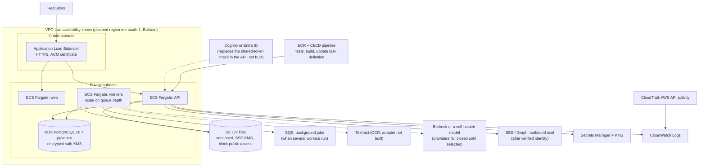

| Topic | Plan |
|---|---|
| **Networking** | Private subnets for the application, worker, database and any model; only the load balancer is public; NAT for outbound calls |
| **IAM** | One task role per service; each reads only its own secrets and bucket prefix |
| **Encryption** | RDS and S3 encrypted with a customer KMS key; TLS at the load balancer |
| **Secrets** | Tokens and the database password in Secrets Manager, injected as environment variables; the production start-up check already refuses `dev-` tokens |
| **Backups** | RDS point-in-time recovery (at least 7 days, encrypted); S3 versioning; the 730-day retention archives rather than deletes |
| **Scaling** | API and worker task counts; worker tasks scale on queue depth; RDS size, and a read replica if search load grows |
| **Monitoring and logging** | CloudWatch Logs for the services; CloudTrail for AWS activity; the hub's own audit stays in PostgreSQL |
| **Deployment** | ECR images, a pipeline that runs the tests, builds images and updates the ECS task definition. **No pipeline exists in this repository yet** |
| **Cost** | Planning range about **$180 to $260 per month** before any model line, for 5,000 new CVs and 20 requests a month: RDS, three small Fargate services, ALB, one NAT gateway and small lines for S3, secrets, KMS and logs. The model is not priced |

**What the code already supports for this move:** configuration through environment variables, replaceable providers (extractor, embedder, requirement
reader, mail sender), content-hash storage keys that map to S3 keys, a refusing production start-up check, and a job queue that can sit behind SQS.
**What it does not:** the S3 storage adapter, the Textract adapter, the Bedrock providers (placeholders), per-person sign-in, and the mail senders.

---

## 27. Copilot Studio versus a dedicated backend

**This product was not built in Copilot Studio, and nothing here was built or tested in it.** The comparison below is a design comparison from published
Microsoft capabilities; points that need confirming with Microsoft are marked in [`COPILOT_STUDIO.md`](docs/superpowers/final-master-verification/COPILOT_STUDIO.md)
rather than asserted.

| | Copilot Studio is strong at | A dedicated backend is strong at |
|---|---|---|
| **Reach** | SharePoint, OneDrive, Outlook and Teams, where Cadence's recruiters and documents already are | Whatever it is connected to (today: upload, form and Excel only) |
| **Identity** | Entra ID sign-in, per-person permissions | Two shared role tokens today; per-person sign-in is future work |
| **Adoption and orchestration** | Triggers, conversation, hand-offs, approvals, reminders | A purpose-built review screen for comparing CVs and reading evidence |
| **Data model** | Reading and writing a store | Candidate vs CV-version model, identity and duplicate rules, evidence per fact |
| **Rules that must be exact** | Can follow instructions | Frozen, unit-tested and replayable: mandatory gates, approval gates, scoring |
| **Audit and testing** | Tenant-level activity records | A domain audit with database-level refusal of edits; a 376-test suite and corpus runs |

**A hybrid is the realistic production shape:**

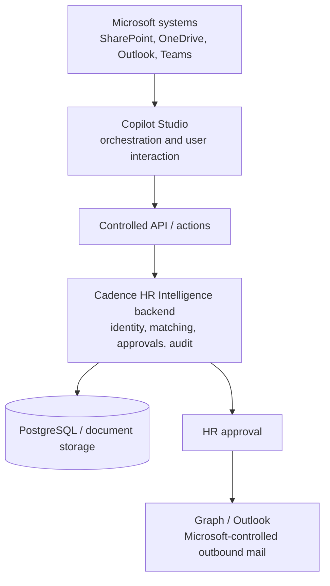

The backend remains the **enforcement boundary**: the agent would call the same endpoints a person does and is refused the consequential ones
(`human_required` / 403). What the hub does worse than a Copilot pilot today: no SharePoint or OneDrive connection, no Entra sign-in, and mail that stops
at a local catcher.

---

## 28. Design decisions and trade-offs

| Decision | Chosen | Alternative | Why |
|---|---|---|---|
| Search | PostgreSQL full-text + trigram + pgvector | A separate search engine such as Elasticsearch | One transactional store keeps candidates, evidence and search in step, and needs no second system. At the size tested (472 documents) this was enough; it was **not benchmarked against alternatives** and would be revisited if the corpus grew a great deal |
| Vectors | `pgvector` column in the same database, fed by a local hash | A dedicated vector database; a real embedding model | The schema is ready for a real embedder without a new system; none was evaluated, so the vectors are an approximation, not semantic search |
| Queue | PostgreSQL job table (`SKIP LOCKED`, leases, unique idempotency key) | Redis or SQS now | No extra infrastructure to run locally; idempotency is a database constraint. SQS is the planned production option |
| Compute | Docker Compose locally; ECS Fargate in the plan | Kubernetes | A few services and no cluster to operate; Fargate runs the same images |
| CV reading | Deterministic parser with quote verification | An LLM extractor | No per-file cost or privacy exposure, reproducible results, every fact quotes its source. The cost: heuristic parsing misreads some layouts (section 29) |
| Identity | Weighted deterministic signals a person confirms | An LLM or a trained classifier deciding | Explainable, testable, and the cost of a wrong merge is high |
| Requirement reading | Rules by default; an optional small local model | A large hosted model | A job description never leaves the machine; HR approval makes a weak model acceptable. A larger model is configuration, not evaluated |
| File storage | Content-hash keys on a volume (S3 in the plan) | Blobs in the database | Hash keys give deduplication and map directly to S3 keys |
| Authorization | Role checks in the API | Frontend-only controls | The UI is not a security boundary |
| Consequential actions | A recruiter approves each one | Autonomous agents | Matching, shortlist and sharing change what a company is told about a person |
| State changes | One transition function plus constraints | Direct status updates | Makes double-actions and skipped steps impossible, and testable |

---

## 29. Known limitations and what production still needs

### Known limitations

| Area | Current limitation | Production direction |
|---|---|---|
| Sign-in | Two shared bearer tokens; the `users.password_hash` column is empty; the web app is recruiter-only and there is no engineer screen | Cognito or Entra ID, per-person identity and per-person audit |
| Integrations | SharePoint and OneDrive are not connected; CVs enter by upload, the sourcing form or Excel. Mail stops at Mailpit; Graph and SES refuse to send | Microsoft Graph with least-privilege permissions; SES or Graph for outbound mail |
| Search | Vectors are a token hash, not a semantic model | An approved embedding model behind the existing 1,024-dimension column, evaluated on labelled queries |
| CV parsing | Heuristic. Multi-column and designer layouts mis-assign some fields; employer and title are sometimes wrong; some profiles carry noisy education or skill rows; Arabic CVs are searchable but only partly parsed. On the latest import, the most common stored "job title" was `CA` (41 candidates, a location) and the most common education "credential" was `Berkeley` (160, an institution), and skills were extracted for only 54% of candidates | Layout-aware extraction (for example a managed document-understanding service) validated against a labelled sample; matching on skills and years is more reliable than on title or degree today |
| Identity weights | A starting point, not a validated model; no labelled evaluation set was built | Label a sample of pairs and tune the thresholds |
| Audit | A database owner or superuser can disable the trigger; the app connects as the owner | A least-privilege application role; ship audit rows to write-once storage |
| Requirement model | The optional 3B model misses or mis-rates some requirements and can time out on small hardware | A larger approved model, measured; HR approval stays |
| Requests | Nothing closes or cancels a request, so there is no "Completed" state | A close/cancel action with its own approval and audit |
| Provisional pool | Per-candidate provisional verdicts are overwritten by the re-match (the audit and agent runs remain) | Keep a per-run history if reviewers need it |
| Export / backup | No full download of the CV store; backups are a local job; AWS backup is a plan | RDS point-in-time recovery, S3 versioning |
| Worker | One sequential worker; a 60 s job lease | SQS and several workers with a longer lease |
| Security hardening | No rate limiting, no malware scanning, no TLS locally | WAF and rate limits at the edge; scanning on upload |
| CI | No pipeline in the repository | Run both suites and the typecheck on every change |
| Demo reset | The reset tool exists only with `ENVIRONMENT=local`; Mailpit is not cleared by it | Not for production |
| Real CVs in git history | The first commit contains the CV files; `cvs/` is now ignored and untracked, but history was not rewritten | Rewrite history or move the data out if the repository is shared |

### What I would change for production

**Already implemented:** the full workflow, deterministic identity and matching, evidence for every fact, append-only audit (with the owner caveat), role checks on
every route, one-time sharing under concurrency, retry-safe imports, provider interfaces for the model, OCR, embeddings and mail, a refusing production
start-up check, local backup and retention.

**Production hardening still required:** per-person enterprise identity; Microsoft Graph integration for documents and mail; S3 with KMS and the storage
adapter; a managed OCR adapter; an approved production model and embedding model with an evaluation set; stronger upload scanning; managed backups and
retention configuration; a least-privilege database role; observability beyond logs (metrics and alerts); a CI/CD pipeline; and a scaling review of search
if the corpus grows.

---

## 30. Project structure

```text
.
├── backend/                     FastAPI API, worker and domain code
│   ├── app/
│   │   ├── api/                 routes, auth dependencies (deps.py): 53 routes, 2 of them local-only
│   │   ├── domain/              rules with no I/O: confidence.py (identity), matching.py (eligibility, score),
│   │   │                        requirements.py, requirement_schema.py, protected.py, transitions.py
│   │   ├── extraction/          PDF / DOCX / DOC / OCR readers, section parser, contacts, embeddings, LLM reader
│   │   ├── services/            pipeline, ingest, hiring, matching, sharing, search, reviews, merge, excel, audit, ...
│   │   ├── jobs/                PostgreSQL queue (leases, retries) and the worker loop
│   │   ├── models/              SQLAlchemy models (core.py, hiring.py)
│   │   ├── storage/             content-hash file storage
│   │   ├── bootstrap.py         provisions the two local users
│   │   ├── backup_job.py        local backup
│   │   └── retention_job.py     730-day archive
│   ├── alembic/versions/        18 migrations
│   ├── tests/                   pytest suite (376 passed, 1 skipped)
│   └── Dockerfile               Python 3.13, LibreOffice Writer, Tesseract
├── web/                         Next.js 15 recruiter desk
│   ├── app/                     routes: demo (setup), hiring, candidates, search, queue, compare, merge, intake,
│   │                            source, data, audit, reports, command
│   ├── components/              ui/ (design system), shell/ (sidebar, tabs, PWA install)
│   ├── lib/                     API client, upload batch, labels, view logic; lib/__tests__
│   ├── public/                  service worker (static assets and offline page only), icons
│   └── Dockerfile
├── docs/
│   ├── readme/                  README screenshots (captured by scripts/capture_readme_screenshots.py)
│   ├── operations.md            local operations, auth, audit, backup, retention
│   ├── comparison-workspace.md  the CV comparison screen
│   ├── challenge-brief.md       the original challenge brief (the previous README)
│   └── superpowers/             design specs, plans, and verification logs from earlier runs
├── scripts/                     browser import check, README screenshot capture, corpus baseline, walkthroughs
├── cvs/                         the real CV corpus: local only, git-ignored, never commit
├── docker-compose.yml           postgres, mailpit, migrate, api, worker, web
├── docker-compose.ollama.yml    optional local model overlay
├── REQUIREMENTS.md              the HR team's requirement list (the scope)
├── SUBMISSION.md                the earlier submission and audit record
└── README.md
```

---

## 31. Documentation index and data handling

| Document | What it holds |
|---|---|
| [`REQUIREMENTS.md`](REQUIREMENTS.md) | The HR team's full requirement list, the scope this was built against |
| [`docs/challenge-brief.md`](docs/challenge-brief.md) | The original challenge brief, preserved from the previous README |
| [`SUBMISSION.md`](SUBMISSION.md) | The earlier submission and audit record. Its figures predate the latest identity-scoring changes; where it differs from this README, this README follows the current code |
| [`docs/operations.md`](docs/operations.md) | Local operations, authentication, audit, backup and retention |
| [`docs/comparison-workspace.md`](docs/comparison-workspace.md) | The CV comparison screen |
| [`docs/superpowers/final-master-verification/`](docs/superpowers/final-master-verification/) | Earlier verification notes: AI architecture, Copilot Studio comparison, requirements matrix |

**Data handling.** Most files in `cvs/` belong to real people (names, phone numbers, emails, addresses, photos). Use them only for this project, keep the
repository private, and do not commit the CVs, extracted text, embeddings, screenshots that show candidates, or database dumps. `cvs/` is listed in
`.gitignore`. The README screenshots in `docs/readme/` were captured only from screens that carry no candidate data.
