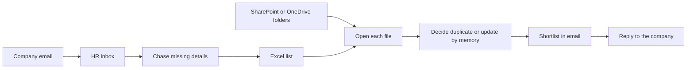

# Cadence HR Intelligence Hub — submission

This document matches the code, tests, and the local corpus baseline as of 30 September 2026. It does not change product behavior.

The backend suite is **126 tests, all passing**. SharePoint, OneDrive, Microsoft Copilot, per-person production sign-in, production embedding models, and the challenge Excel workbook are not implemented and were not tested.

## 1. How to run it

From a fresh clone, with Docker running, one command at the repository root:

```text
docker compose up --build -d
```

Compose builds the current API, worker, and web image, waits for Postgres, runs migrations, provisions the two demo users, then starts the API, worker, web app, and Mailpit. An empty database volume is enough. Do not start a host API or worker before that command.

| Surface | URL |
|---|---|
| Recruiter web app | http://localhost:3000 |
| API | http://localhost:8000 |
| API health | http://localhost:8000/health |
| Mail catcher | http://localhost:8025 |

Point the app at the local `cvs/` folder. Do not commit that folder, extracted text, embeddings, or a database dump.

A local backup of the running stack:

```text
docker compose exec api python -m app.backup_job
```

Retention can also be run by hand:

```text
docker compose exec api python -m app.retention_job
```

The worker applies retention when it starts.

## 2. Demo accounts and roles

Sign-in is a shared bearer token for a role. There is no password. The local token values live in Compose and in `docs/operations.md`. They are omitted from this file. They are accepted only when `ENVIRONMENT=local`. Any other environment refuses a token that begins with the demo prefix, and the process does not start.

| Role | Account | What this role can do |
|---|---|---|
| Recruiter | `recruiter@cadence.local` | CV intake, relationship review, hiring requests, match review, shortlist, share approval and send, profile merge, Excel import and export, candidate contacts and CV text, dashboard, work queue, problem reports |
| Engineer | `engineer@cadence.local` | List and update problem reports. Hiring, candidate contacts, CV text, merge, shortlist, share, and Excel import/export return 403 |

The web app sends the recruiter token that Compose injects at image build time. An engineer uses the engineer token against the API. System and agent actors are not HTTP users. They cannot merge, shortlist, share, or import a spreadsheet.

`GET /health`, `/docs`, and `/openapi.json` do not require a token. Every other API route returns 401 when the `Authorization` header is missing.

## 3. Requirements coverage

Status meanings: **PASS** is implemented and covered by the product tests or a checked screen. **PARTIAL** is implemented with a stated limit. **FAIL** is missing. **NOT TESTABLE** is used for the challenge workbook, which is not in this clone. No requirement below is FAIL.

| ID | Status | Where it lives | How to see it |
|---|---|---|---|
| 1.1 | PASS | Postgres profiles plus content-addressed files | Upload on `/`. Open `/candidates/{id}` |
| 1.2 | PARTIAL | CV upload and `.xlsx` import. SharePoint and OneDrive are not connected. The challenge workbook is not in the clone | `/` and `/data`. See the workbook section |
| 1.3 | PASS | One candidate row. Identical file bytes stay one document | Intake. A second upload of the same bytes does not create a second profile |
| 1.4 | PASS | Profile read model: name, contacts, experience, education, skills, certificates, qualifications, applications, years | `/candidates/{id}` as a recruiter. The 488-file baseline ran with the section parser off, so those stored rows do not yet hold section fields |
| 1.5 | PASS | HR `accept_update` keeps one profile and marks the latest document current. Older documents stay as superseded | Intake decision, then the profile |
| 2.1 | PARTIAL | PDF text layer via PyMuPDF, DOCX via python-docx, legacy `.doc` via LibreOffice. Scans use Tesseract when the binary is installed | Compose image includes LibreOffice and Tesseract. The recorded corpus run was on a host without either, so six files stayed `needs_ocr` |
| 2.2 | PARTIAL | Chunk full-text search plus a local hash vector. Filename is not the search key | `/search`. Files still in `needs_ocr` have no searchable text. The vector is a token hash, not a semantic embedding model |
| 2.3 | PASS | Name, skill, years, education, qualification, certificate, industry, job title, nationality | `/search`. Nationality matches text already in the CV and is not inferred or stored. Industry matches employer and description. Job title matches experience titles |
| 2.4 | PASS | Result list with a link to the profile | `/search` |
| 3.1 | PASS | Approved requirements compared with the profile. An embedding cannot clear a mandatory gap | `/hiring` after requirement approval |
| 3.2 | PASS | Dispositions: recommended, needs review, rejected | Match list on the hiring request |
| 3.3 | PASS | Meets, gaps, relevant evidence, strengths in the match explanation | Match review. Evidence quotes are checked against the source text before they are stored |
| 3.4 | PASS | Stored summary, or one sentence built from years, the first role, and skill names already on the profile | Candidate profile. No model writes this sentence |
| 3.5 | PASS | Match does not shortlist, approve, or send | `/hiring`. Share requires a shortlist, an approval, and an explicit send |
| 4.1 | PASS | A second application opens a relationship review. HR chooses update, duplicate, or a different person | `/` and `/queue` |
| 4.2 | PASS | Email, phone, and name are the identity signals. Filename is ignored | Review evidence on the intake screen |
| 4.3 | PASS | `accept_update` writes onto the existing profile | Review decision |
| 4.4 | PASS | Recruiter merge. The older profile survives. History is kept. Engineer and system actors cannot merge | `/merge` |
| 4.5 | PASS | Current document flag, superseded documents, applications ordered by the time they were received | Candidate profile |
| 5.1 | PASS | `company_name` on the hiring request | `/hiring` |
| 5.2 | PASS | `job_title` | `/hiring` |
| 5.3 | PASS | Description plus proposed requirements that stay proposed until HR approves them | `/hiring` |
| 5.4 | PASS | `received_at` | Request detail |
| 5.5 | PASS | Owner user on the request | Request detail and the quarterly export |
| 5.6 | PASS | Candidate matches for the request | Request detail |
| 5.7 | PASS | Sharing records after an approved send | Request detail |
| 5.8 | PASS | Quarterly `.xlsx` of hiring activity. Cells that contain an email address or a long digit run are blanked | Export from the data screen. Dates filter the rows |
| 5.9 | PASS | Request notes | `/hiring` |
| 5.10 | PASS | Request attachments | `/hiring` |
| 5.11 | PASS | Updates and next steps | `/hiring` |
| 5.12 | PASS | The request, its matches, shares, notes, and the audit trail are the record of support | `/hiring` and the export |
| 6.1 | PASS | Source types include LinkedIn and other recruiter-entered sources | `/source` |
| 6.2 | PASS | Name, contact, and CV are submitted together. The CV still goes through intake | `/source` |
| 6.3 | PASS | An email or phone match opens a relationship review and does not create a second profile by itself | `/source`, then the review |
| 6.4 | PASS | Source type and source reference are stored and shown | Profile and the sourced-candidate screen |
| 7.1 | PARTIAL | Recruiter-only candidate contacts, CV text, and evidence. Engineer problem reports stay available | Engineer calls to `/candidates/{id}` and `/documents/{id}/text` return 403 and omit the contact and the quote |
| 7.2 | PARTIAL | Local backup copies tables and stored files. The hiring export is a workbook. There is no full CV-store download | `python -m app.backup_job` |
| 7.3 | PARTIAL | Every protected route requires a bearer token and a role. Production per-person sign-in is not built | Missing token is 401. Wrong role is 403 |
| 7.4 | PARTIAL | Controls in the security section. The remaining gaps are listed at the end | `backend/tests/test_security.py` and `backend/tests/test_pii_access.py` |
| 7.5 | PASS | `audit_events` is insert-only. A database trigger rejects update and delete | Security tests. The table owner can still truncate the table or drop the trigger |
| 7.6 | PASS | Local backup is implemented and tested. The manifest sets `aws_backup_implemented` to false | `backend/tests/test_backup.py` |
| 7.7 | PASS | Finished and terminal documents are archived 730 days after receipt. Rows are kept. In-progress documents are left alone | `backend/tests/test_retention.py` |
| 8.1 | PASS | One recruiter desk: intake, dashboard, queue, hiring, search, profile, source, reports, data, merge | `/dashboard`. A stranger handoff is the judging-day exercise and was not recorded here |
| 8.2 | PASS | The dashboard reads stored counts for reviews, requirement approvals, match reviews, shortlists, share approvals, open problem reports, recent audit events, and active hiring requests | `/dashboard` and `/queue` |
| 8.3 | PARTIAL | Excel import and export work. Local mail is SMTP to Mailpit. Graph and SES classes exist and refuse to send until a production mailbox is configured. SharePoint and OneDrive are not connected | `/data`, Mailpit on port 8025 |
| 8.4 | PASS | Extractor, embedder, requirement reader, and mail sender are replaceable providers. New work is another module, not a rewrite of identity scoring | `app/extraction/provider.py`, `app/services/mail.py` |
| 8.5 | PASS | Dashboard, queue, profile, hiring, search, and intake were checked at a 390×844 viewport and stayed within the screen | Those routes on a phone-width browser |

## 4. Current process

Today a company emails the HR team. Someone reads the email, copies the company, role, and requirements by hand, and chases anything missing. CVs live in SharePoint or OneDrive. Contacts and earlier applications live in Excel. Search is by file name. Matching means opening files one by one. Nothing decides whether a new file is the same person, an updated CV, or someone else. A sourced candidate has nowhere to go. The shortlist goes out by email with no single record of who handled the request or which CVs were sent.



Time goes into reading, re-reading, and reconstructing history. Information is lost when a newer file does not replace the old one, when a LinkedIn find never meets the folder, and when nobody can say which CVs a company already received.

## 5. New process

A file or a sourced CV enters intake. A worker extracts text, classifies the document, and either creates a profile, opens a relationship review, marks the file as needing OCR, or quarantines it. A company request is entered in the hub. A deterministic reader proposes requirements. A recruiter approves them. The matcher explains each candidate against those requirements. A recruiter shortlists, approves a share, and sends. The send goes to Mailpit in the local demo. A problem report from the same screen is visible to the engineer account.

```mermaid
flowchart TD
  upload[CV upload or sourced CV] --> job[extract_document job]
  job --> text[Deterministic text extract]
  text --> class[Deterministic CV or non-CV gate]
  class --> ocr{Text layer present?}
  ocr -->|No| needsOcr[needs_ocr]
  ocr -->|Yes| identity[Deterministic identity signals]
  identity --> same{Identical bytes?}
  same -->|Yes| oneDoc[Keep the existing document]
  same -->|No| review{Email, phone, or name overlap?}
  review -->|Yes| humanReview[Recruiter relationship decision]
  review -->|No| profile[New profile]
  humanReview --> profile
  request[Hiring request] --> propose[Deterministic requirement proposal]
  propose --> approveReq[Recruiter approves requirements]
  approveReq --> match[Deterministic matcher]
  match --> short[Recruiter shortlist]
  short --> approveShare[Recruiter share approval]
  approveShare --> send[Explicit send]
  send --> mailpit[Mailpit]
  problem[Problem report] --> engineer[Engineer queue]
```

Agents in this build are background jobs with a recorded `agent_run`. They do not call a language model.

| Agent | Trigger | Allowed to do | Not allowed to do |
|---|---|---|---|
| `candidate_extractor` | Document job after upload | Read bytes, extract text, classify, propose a profile or a review | Merge profiles, shortlist, send mail |
| `requirement_extractor` | Recruiter asks to read a job description | Propose requirements with quotes | Approve requirements or open a search |
| `candidate_matcher` | Recruiter runs matching on an open request | Score approved requirements and write match rows | Shortlist, approve a share, or send |

## 6. Decision boundaries

| Decision | Who decides | What the code does |
|---|---|---|
| Identical sha256 | Deterministic | Keep one document. No review and no second profile |
| Email, phone, or name overlap | Human recruiter | Open a review. Recommended action is a suggestion. HR chooses update, duplicate, or a different candidate |
| Filename wording | Ignored | Never used as identity |
| Model self-confidence | Ignored | Relationship confidence is a weighted score in `app/domain/confidence.py` |
| Non-CV text | Deterministic | Quarantine with `non_cv_invoice`, `non_cv_cover_letter`, or `non_cv_job_description` |
| No text layer | Deterministic | `needs_ocr`. Tesseract runs only when it is installed. A failed OCR does not invent text |
| Section fields and contacts | Deterministic parser | Quotes must appear in the source text. Instruction-like lines are dropped |
| Nationality, age, gender, religion | Not inferred | The parser skips those topics. Nationality search is a text filter the recruiter types |
| Requirement lines | Deterministic proposal, human approval | Proposed rows do not match anyone until a recruiter approves them |
| Mandatory gap | Deterministic | A vector similarity cannot mark a mandatory requirement as met |
| Shortlist, reject, share approval, send, merge | Human recruiter | Each call checks the actor. System, agent, and engineer actors stop before the write |
| Excel row that matches an email or phone | Human recruiter | Opens a relationship review. The profile is unchanged until HR chooses |
| Problem-report status | Human engineer | Recruiter can open a report. Engineer updates it. The report does not grant candidate access |
| Audit row | Append-only | Inserts succeed. Update and delete are rejected by a database trigger |

## 7. AWS production architecture

This is a plan. Nothing in this section is deployed. Moving it is configuration: image, environment, secrets, and the database URL. Bedrock providers in the code raise "unavailable" until a model is deliberately selected.

Region: **me-south-1 (Bahrain)**, because that is the AWS region next to Cadence. Two availability zones.

| Piece | AWS service | Role |
|---|---|---|
| Network | VPC, private subnets, one NAT gateway | API, worker, and database have no public addresses |
| Edge | Application Load Balancer, HTTPS | Web and API. TLS from ACM |
| Web and API | ECS Fargate | The same images Compose builds |
| Worker | ECS Fargate | Extraction, OCR, retention. Scale the task count when the queue grows |
| Database | RDS PostgreSQL 16 with pgvector | Private subnets. Encryption at rest. Automated backups |
| Files | S3, versioning, block public access | Replaces the local storage directory. Keys stay content hashes |
| Secrets | Secrets Manager | Recruiter token, engineer token, database password. The task role can read them. Demo token values are refused because `ENVIRONMENT=production` |
| Sign-in | Current token check, fed from Secrets Manager | Per-person sign-in is a later replacement of `current_auth`. It is not built |
| Mail | SES, after a verified identity | `SesMailSender` exists and refuses to send until that identity exists. Local demo stays on Mailpit |
| Logs | CloudWatch Logs | API, worker, and RDS logs. Audit rows stay in Postgres |
| Images | ECR | Built in CI and deployed by updating the ECS task definition |
| Backups | RDS automated backups, at least 7 days, encrypted. S3 versioning for files | The local job's manifest keeps `aws_backup_implemented` false until this exists |
| Staff access | IAM roles for deployers. Security groups allow the API to reach RDS on 5432 only | No database port on the internet |

Embeddings and extraction stay on the deterministic providers until Cadence approves a Bedrock model that does not train on customer content. Switching provider is an environment value, not a new workflow.

## 8. Monthly cost

Workload: **5,000 new CVs and 20 hiring requests a month**. The recorded corpus averages **146 KB per file** (488 files, 69.5 MB). At that size, 5,000 files are about **0.7 GB of new objects per month**, about **8.4 GB after a year**. Twenty requests do not change the instance size.

The current pipeline's model bill is **$0**. It does not call Bedrock, and the corpus baseline called no embedding API.

Prices below are public list estimates, not an AWS quote. RDS uses the me-south-1 on-demand figure published for `db.t4g.medium` PostgreSQL (about **$55 per month**, compiled 31 August 2026). Fargate, ALB, and NAT use commonly published US East rates and are a floor for Bahrain, where compute is often higher. Hours per month are 730.

| Line | Working | USD / month |
|---|---|---|
| RDS `db.t4g.medium`, single-AZ | me-south-1 on-demand | 55 |
| RDS gp3, 50 GB | US East about $0.115/GB. Budget $8 for Bahrain | 8 |
| Fargate API, 0.5 vCPU and 1 GB | `0.5 × 0.04048 × 730 + 1 × 0.004445 × 730` | 18.02 |
| Fargate worker, same size | OCR and extraction fit in the always-on task. 5,000 files at the baseline mean of 104 ms is under a minute of CPU | 18.02 |
| Fargate web, 0.25 vCPU and 0.5 GB | `0.25 × 0.04048 × 730 + 0.5 × 0.004445 × 730` | 9.01 |
| Application Load Balancer | `$0.0225 × 730`, plus a small LCU allowance | 20 |
| NAT gateway, one AZ | `$0.045 × 730`. Data processing at this volume is about $1 | 34 |
| S3 for a year of CVs | 8.4 GB × about $0.025 | 1 |
| Secrets Manager, three secrets | `3 × $0.40` | 1.20 |
| CloudWatch logs, a few GB | Ingestion allowance | 2 |
| Model calls | None in this build | 0 |
| **Single-AZ total** | | **about $166** |
| Multi-AZ RDS instead of single-AZ | Add another instance at the same $55 | **about $221** |

A planning range of **$180 to $260 per month** covers Bahrain compute premiums, tax, and a little log growth. Support plans and cross-region transfer are extra. Reserved instances would lower the RDS line; they are not required for the first month.

If Cadence later enables a hosted embedding model, a few million tokens for 5,000 CVs is cents to a few dollars at published embedding rates. That switch is not turned on, and this estimate does not include it.

## 9. AI component inventory

"AI" here includes OCR, classification, similarity, and ranking. A language model is not one of the running components.

| Component | Provider / model | Where it is used | Why this, and why not only a hand rule | Validation | When it fails | Cost |
|---|---|---|---|---|---|---|
| Text extraction | PyMuPDF, python-docx, LibreOffice | PDF, DOCX, legacy DOC | The file format has a parser. A model would add drift | Corpus baseline and extraction tests | Encrypted or corrupt files are quarantined with `encrypted_pdf` or `corrupt_pdf`. The next file still runs | $0 |
| OCR | Tesseract through `TesseractOcrAdapter` | Files with no text layer | A scan has no text layer to parse | Adapter tests. The six corpus scans were not re-run inside the Compose image | Missing binary raises `ocr_unavailable` and the document stays `needs_ocr`. Empty OCR text does not become a candidate | $0 |
| CV / non-CV gate | Deterministic phrases in `classify_document` | After text extraction | Invoice, cover letter, and job-description cues are stable phrases. Filename is not an input | Corpus re-run quarantined one of each. Tests cover the three reasons | A CV that merely contains one noisy word stays a CV. A real non-CV with none of the phrases can still become a profile | $0 |
| Script detection | Character counts in `detect_language` | Stored on the document as `en`, `ar`, `mul`, or `unknown` | Script is countable. It is not a nationality | Unit behavior in the pipeline | Unknown script is stored as `unknown`. The file is still processed | $0 |
| Section parser | `deterministic-section-parser` | Experience, education, skills, certificates, qualifications, contacts | Headings and contact patterns have a right answer. The parser reports no confidence | Quote must occur in the source. Instruction-like lines are dropped. Compose sets this provider | `extractor_provider=none` skips it, which is how the 488-file baseline was run. A missed heading leaves that section empty rather than inventing it | $0 |
| Local hash embedding | `local-feature-hash`, 1024 dimensions | Hybrid search and match support | Shared tokens need a vector column so a later model can replace it without a schema change. It is not a meaning model | Search tests. Mandatory gaps ignore the vector | `embedding_provider=none` stores no vector. `bedrock` raises `EmbeddingUnavailable` | $0 |
| Relationship score | Weighted email, phone, name, and CV-overlap signals | Opens a review and a recommended action | The weights are explainable and tested. A model's confidence is not an input | `backend/tests/test_rules.py` and the corpus identity counts | Below the cutoff, or an ambiguous pair, the recruiter still decides. Nothing auto-merges | $0 |
| Requirement reader | `deterministic-requirement-parser` | Proposes rows from a job description | Labeled lines and a few phrases are checkable. Sensitive attributes are rejected | Requirement-review tests. HR must approve before matching | `bedrock` raises unavailable. Unparsed text stays in the description for the recruiter | $0 |
| Matcher | `candidate_matcher`, deterministic explain | Meets, gaps, disposition | Each requirement is met or not from stored fields and evidence. Preferred gaps do not exclude someone | Matching tests. Evidence quote is a substring of the CV | No approved requirements means no match run. A missing skill is a gap, not a hidden rejection | $0 |
| Bedrock extractor, embedder, and requirement reader | Placeholders named `bedrock` | Not called | Reserved so production can switch provider without a new workflow | They are asserted to raise | The call fails closed. No partial profile is written from a model | $0 spent |

## 10. Copilot Studio

Copilot Studio would do several things well. Cadence already lives in Microsoft 365. A Copilot agent can sit next to Outlook, and the Graph connectors for SharePoint and OneDrive are the shortest path to the folders the team uses today. Entra ID would give per-person sign-in, which this hub does not have yet. A low-code agent is a fast way to demo "ask the folder a question." For a team that will not learn a new tool, that familiarity matters, and the judging brief says a one-sided argument should score lower.

This problem still wants a system of record with tests, not a chat window as the main screen. The brief says the hub is not a chatbot. The costly mistakes are specific: joining two people, sending a candidate before a recruiter agrees, and inventing a skill that is not in the CV. Those are pass/fail rules. The hub encodes them: identical bytes dedupe, every other identity overlap waits for a named recruiter, evidence quotes must exist in the source, a mandatory gap cannot be cleared by similarity, and send is a separate approval. A Copilot topic can be prompted to behave that way, and the next model change can drift. The 488-file run is a regression suite with counts. Replaying that against a hosted agent is slower, costs money per file, and is harder to freeze.

Copilot Studio also makes the audit and privacy story harder. This hub stores an append-only audit of ids and codes, keeps CV text out of that audit, and gives engineers problem reports without candidate contacts. A studio agent that can read the tenant can answer from places the retention job does not cover. Data-loss controls then depend on the tenant configuration as much as on the agent. The hub's retention clock and backup folder are ordinary database and file operations.

What this hub does worse than Copilot Studio today is the Microsoft estate. SharePoint and OneDrive are not connected. Outlook is a local Mailpit inbox, with Graph and SES left as refusals until Cadence configures them. Staff share two demo tokens. A production Copilot pilot would be ahead on those three points on day one. The hub is ahead on review queues, evidence, duplicate control, and the ability to show a test for each of those rules.

## 11. Corpus baseline

Counted on disk on 30 September 2026: **488 files** (459 PDF, 26 DOCX, 2 JPEG, 1 JPG). No spreadsheet is in `cvs/`.

The full pipeline run was on 29 September 2026 against an empty database named `hub_baseline`. Extractor provider was `none`. Embedding provider was `none`. No language-model call and no embedding API call. The host had no Tesseract and no LibreOffice on `PATH`. The report is local and gitignored at `backend/var/baseline/`. It is counts, codes, and filenames. Filenames are omitted here. The Compose database named `hub` is not that corpus.

| Measure | Result |
|---|---|
| Files discovered and accounted | 488 |
| Documents stored | 472 |
| Identical-byte extras | 16 groups, 16 extra files, recognized as the same document |
| Successfully extracted | 461 |
| New candidate profiles | 364 |
| Relationship reviews opened | 97 |
| Attached to an existing candidate during the run | 0 |
| Needs OCR | 6, error `ocr_unavailable` |
| Quarantined | 5 |
| Rejected before a document was stored | 0 |
| Non-CV quarantined by the text gate | 3 |
| Stuck jobs | 0 |
| Unexpected failures | 0 |
| Detected types | 460 PDF, 25 DOCX, 3 JPEG |
| Text source | 455 text layer, 25 DOCX, 3 image |
| Identity outcome, file rows | new 376, updated CV 79, different candidate 19, ambiguous 3 |
| Document status, file rows | extracted 376, needs review 101, needs OCR 6, quarantined 5 |
| Pages, where a page count existed | count 477, min 1, max 5, mean 1.1 |
| Characters | min 0, max 10614, mean 3538 |
| Per-file processing time | min 7.7 ms, max 349 ms, mean 104 ms, sum 50.8 seconds |
| Model cost | $0 |

File-level status counts include the 16 identical copies, which inherit the original document. Unique documents are 472: 461 extracted, 6 needing OCR, and 5 quarantined. One file whose name ends in `.docx` was detected as PDF. That detection uses the bytes, not the extension.

The section parser and the local hash embedder were added after this run and were not applied to these 472 documents. Compose uses the section parser for files uploaded after startup. Re-running the 488 files was intentionally not done again.

## 12. OCR, quarantine, and non-CV

| Outcome | Count | Reason |
|---|---|---|
| `needs_ocr` / `ocr_unavailable` | 6 | No usable text layer, and Tesseract was not installed on the host that ran the baseline. The Compose image installs Tesseract. Those six files were not reprocessed there |
| `non_cv_invoice` | 1 | Text contained invoice language and at least two supporting invoice phrases. Filename was not the rule |
| `non_cv_cover_letter` | 1 | Text matched the cover-letter rule |
| `non_cv_job_description` | 1 | Text matched the job-description rule |
| `encrypted_pdf` | 1 | Password-protected PDF. Quarantined. No candidate |
| `corrupt_pdf` | 1 | Unreadable PDF. Quarantined. No candidate |

A quarantined file does not block the next file. A blank scan is not turned into a candidate. Non-CV rows are stored as documents with an error code so they can be audited. They are not confirmed profiles.

## 13. Security controls

| Control | Behavior |
|---|---|
| Authentication | Bearer token from the environment. Demo tokens work only in `ENVIRONMENT=local`. Production refuses them at startup. A failed settings load is not cached |
| Authorization | Recruiter and engineer are separate. System and agent actors cannot perform recruiter writes |
| Missing token | 401 on every route except health, docs, and OpenAPI |
| Candidate PII | Contacts, CV text, and evidence quotes require a recruiter. The engineer response body does not include them |
| Problem reports | Engineer can list and update them. Opening a report does not reveal a CV |
| Audit contents | Allowed keys only. Strings containing `@` are rejected. Floats are rejected |
| Audit storage | Insert-only trigger. Update and delete fail. Public update and delete privileges are revoked. The application role owns the table |
| Excel | Formulas and instruction-like cells are not executed and are not copied into the audit. Export cells with an email or a long number are blanked |
| Mail | Local environment sends only to localhost, loopback, or Mailpit. Graph and SES raise until configured |
| Uploads | Size cap. Unsupported types are rejected. Storage keys are content hashes |
| Inference | Nationality, age, gender, and religion are not inferred from a name, a school, or a photo |
| Secrets in source | Token fields have no default. The web client sends a token only when the environment provides one |
| Tests | `test_security.py` covers 401, 403, audit update, audit delete, PII, sharing, merge, shortlist, problem reports, and Excel |

## 14. Backup and retention

Local backup writes a timestamped folder of table snapshots and stored files under `BACKUP_DIR` (in Compose, `/var/backups` on its own volume). Source rows are not deleted. The manifest says `aws_backup_implemented: false`.

The production backup plan, not deployed, is RDS automated backups with point-in-time recovery, encrypted, kept at least 7 days, and CV objects in S3 with versioning.

Retention is 730 days. Documents in `extracted`, `needs_review`, `profiled`, `needs_ocr`, `failed`, or `quarantined` move to `archived` after that age. Archived rows stay. Documents still being processed are skipped. The worker runs this on startup. An audit event records the count, not the document text.

## 15. Human approval

A recruiter decides every change that other people rely on, and every message that leaves the hub.

1. Relationship review: update the existing profile, record a duplicate, or create a separate candidate.
2. Requirement approval: proposed lines do not drive matching until approved.
3. Match review: shortlist or reject. The matcher does not shortlist.
4. Share approval, then a separate send. The local message lands in Mailpit.
5. Profile merge: explicit confirmation. The older profile survives.
6. Excel relationship: a matching email or phone waits for the same review decision.
7. Problem report: the recruiter writes it; the engineer changes status. That does not approve a candidate.

The dashboard and the work queue link to those screens. Opening a row does not decide it.

## 16. Known gaps

- SharePoint and OneDrive are not connected. CVs enter by upload, by the sourced-candidate form, or by Excel.
- The challenge Excel workbook is not in the clone. See the next section.
- The 488-file baseline did not run the section parser or the hash embedder, and it did not run OCR, because that host had no Tesseract. The six `needs_ocr` files are still unread.
- Search vectors are a local token hash. A semantic embedding model is not in use. The Bedrock providers fail closed.
- Sign-in is two shared role tokens. Per-person production authentication is not built. OpenAPI and `/docs` are public.
- The database owner can truncate `audit_events` or drop the append-only trigger.
- There is no full download of the CV store. Backup and the hiring workbook are the export paths.
- Graph and SES do not send. Local mail stops at Mailpit.
- AWS backup, RDS, S3, and Bedrock are a plan. `aws_backup_implemented` is false.
- Language codes on the corpus were not recorded in the baseline summary. The current pipeline stores a script code for new documents.
- A first-time user handoff, which the brief uses on judging day, was not run for this package.

## 17. Challenge Excel workbook

**NOT TESTABLE.**

`cvs/` contains 488 files: 459 PDF, 26 DOCX, and 3 JPEG. There is no `.xlsx` in that folder. The workbook the brief says will appear on judging day was not in the clone, so it was not imported and its rows were not compared with an answer key. Other spreadsheets on the machine were not used as a substitute.

The product path is still there and is covered by tests that build a workbook in memory: column mapping, missing and malformed values, formula cells left unexecuted, an email or phone match opening a relationship review, and recruiter-only import and export. Those tests do not claim to have seen the challenge file.
